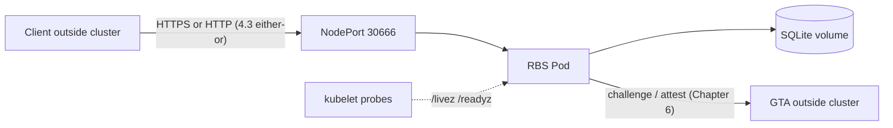

# Deploying RBS on Kubernetes

> Follow the chapters in order; if the actual output doesn't match the expectation, stop and troubleshoot per Chapter 8 before continuing.
> After Chapters 1–5 you have: RBS running in the cluster, the `/livez` and `/readyz` probes returning 200, and the business API reachable from outside via `https://<NODE_IP>:30666`. The business port speaks HTTPS by default; a plain-HTTP variant (no certificates at all; closed demos / trusted intranets only) is selected via Option 2 in 4.3 (Chapter 6 only edits the GTA-related keys incrementally; that choice is untouched — the RBS→GTA protocol has its own independent two-way choice in Chapter 6). Wherever the two modes differ, this guide gives one `# HTTPS` block and one `# HTTP` block — run yours, skip the other.
> Chapter 6 connects a real GTA (Chapters 1–5 run completely without one: deployment, probes and business verification do not depend on GTA). Chapter 7 is entirely optional.

**Table of contents**

- [0. Environment self-check](#0-environment-self-check)
- [1. Start the cluster](#1-start-the-cluster)
- [2. Build and import images](#2-build-and-import-images)
- [3. Generate certificates and keys](#3-generate-certificates-and-keys)
- [4. Deploy](#4-deploy)
- [5. Verify](#5-verify)
- [6. Connect a GTA](#6-connect-a-gta)
- [7. Optional paths](#7-optional-paths-not-required-for-the-mainline)
- [8. Troubleshooting](#8-troubleshooting)
- [9. Integrate the Vault resource backend (OpenBao)](#9-integrate-the-vault-resource-backend-openbao)
- [10. Integrate the HSM resource backend (SoftHSM2)](#10-integrate-the-hsm-resource-backend-softhsm2)
- [11. Integrate the CA resource backend (XiPKI)](#11-integrate-the-ca-resource-backend-xipki)

**Requirements**

| Item | Requirement |
|---|---|
| Machine | ≥ 4 CPUs / 8 GB RAM / 20 GB free disk |
| Operating system | Linux (verified on openEuler; other distros' equivalents apply) |
| Run as | A non-root user with sudo; as root, minikube start needs `--force` |
| Tools | git, Docker, kubectl v1.30+, openssl, curl |
| Cluster tooling | minikube v1.33+ (mainline) or kind (equivalent commands in each chapter) |
| GTA service | only needed in Chapter 6 (base URL, credentials user_id, token-signing public key; Option 1 additionally needs the CA and client certificates) |

**Deployment topology**:



Chapters 1–5 are the mainline: SQLite works out of the box (database and tables are created automatically on first start). Chapter 6 connects the GTA; chapters 9–11 integrate one resource backend each on top of Chapter 6; chapter 7 is entirely optional.

## 0. Environment self-check

```bash
# 1) CLI tools (expect all [OK])
for c in git kubectl docker openssl curl; do
  command -v "$c" >/dev/null 2>&1 && echo "[OK]      $c" || echo "[MISSING] $c"
done

# 2) Cluster tool (minikube or kind — either one is fine)
if command -v minikube >/dev/null 2>&1; then echo "[OK]      minikube"
elif command -v kind >/dev/null 2>&1; then echo "[OK]      kind"
else echo "[MISSING] minikube or kind"; fi

# 3) Memory (see the requirements table at the top)
free -h | awk '/^Mem:/{print "Memory: "$2}'
```

All `[OK]` means pass. Missing kubectl/minikube: run the install commands in 1.1 first; missing git/openssl/curl: install via the system package manager (`apt install` / `dnf install`).

## 1. Start the cluster

> Output of this chapter: a running cluster with the node **Ready** (check and fix per 1.3) + `NODE_IP` (Chapters 3, 5 and 6 depend on it — write it down). 1.1 and 1.2 are **either-or**.

### 1.1 minikube (mainline)

**Install** (skip if already installed; auto-detects architecture x86_64→amd64, aarch64→arm64):

```bash
ARCH=$(uname -m | sed 's/x86_64/amd64/; s/aarch64/arm64/')
curl -LO "https://storage.googleapis.com/minikube/releases/latest/minikube-linux-$ARCH"
sudo install minikube-linux-$ARCH /usr/local/bin/minikube && rm -f minikube-linux-$ARCH
curl -LO "https://dl.k8s.io/release/$(curl -L -s https://dl.k8s.io/release/stable.txt)/bin/linux/$ARCH/kubectl"
sudo install -m 0755 kubectl /usr/local/bin/kubectl && rm -f kubectl
minikube version && kubectl version --client    # two version lines = success; "Exec format error" = wrong architecture, rerun this block
```

**Start and get the node IP**:

```bash
minikube start $([ "$(id -u)" -eq 0 ] && echo --force)    # --force is appended automatically for root users
NODE_IP=$(minikube ip) && echo "NODE_IP=$NODE_IP"         # example: 192.168.49.2
```

The line `🏄  Done! kubectl is now configured to use "minikube" cluster` means success.

> **Note**: base-image pull timeout (`GUEST_PROVISION` with `gcr.io ... Timeout` in the log): the Docker daemon does not inherit shell proxy variables — configure the daemon proxy (`/etc/systemd/system/docker.service.d/http-proxy.conf`) and `systemctl restart docker`; with no usable proxy, fall back to `minikube start --force --image-mirror-country=cn`.

**Proxy environments: add no_proxy** (mandatory on machines with `http_proxy`/`https_proxy` set, otherwise kubectl fails with `Gateway Time-out` and local curl requests get hijacked by the proxy):

```bash
export no_proxy="${no_proxy:+$no_proxy,}localhost,127.0.0.1,$(minikube ip)"    # node IP = API server address; appended to no_proxy, existing value untouched
export NO_PROXY="$no_proxy"
kubectl get nodes    # nodes listed = working; exports are per-terminal — rerun this block in a new one
```

### 1.2 kind (alternative)

```bash
# Install (skip if already installed)
ARCH=$(uname -m | sed 's/x86_64/amd64/; s/aarch64/arm64/')
curl -Lo ./kind "https://kind.sigs.k8s.io/dl/v0.24.0/kind-linux-$ARCH"
sudo install ./kind /usr/local/bin/kind && rm -f ./kind

# Create the cluster
kind create cluster --name rbs
export no_proxy="${no_proxy:+$no_proxy,}localhost,127.0.0.1"    # proxy environments: mandatory (the kind API server sits on 127.0.0.1)
export NO_PROXY="$no_proxy"
NODE_IP=$(kubectl get nodes -o wide | awk '/^rbs-control-plane/{print $6}') && echo "NODE_IP=$NODE_IP"
```

> **Note**: if that IP is unreachable from your machine (kind container network): 5.2 is unaffected (port-forward); for 5.3 use the 8.4 port-forward fallback; cross-machine access additionally needs the 7.1 setup.

### 1.3 Confirm the node is Ready (mandatory)

```bash
kubectl get nodes    # the STATUS column must be Ready
```

> Fix NotReady before continuing: the kubelet is already unreachable, and every symptom that follows (Pods stuck en masse in `Pending`/`Terminating`, `kubectl exec` reporting container not found) traces back to it. Typical trigger: the cluster has not fully recovered after a host/VM restart.

**NotReady fix** (run the line for your chapter-1 choice, then the final wait):

```bash
# minikube: restart the cluster (PVC data is kept; --force is appended automatically for root)
minikube stop && minikube start $([ "$(id -u)" -eq 0 ] && echo --force)

# kind: restart the node container (<container> from docker ps; mainline: rbs-control-plane)
docker restart <container>

# wait for STATUS back to Ready (prints "condition met" on success, 5-minute cap)
kubectl wait --for=condition=Ready node --all --timeout=300s
```

**Still NotReady after stop/start** (the node's Ready-line Message in `kubectl describe node` contains `cni plugin not initialized` = the CNI pod is stuck, usually `ImagePullBackOff` — in-cluster image pulls do not use the host network stack: neither proxy nor DNS match the host):

```bash
IMAGE=$(kubectl get daemonset kindnet -n kube-system -o jsonpath='{.spec.template.spec.containers[0].image}')
docker pull $IMAGE && minikube image load $IMAGE    # pull on the host and load into the cluster; if the pull fails, retag via the docker.m.daocloud.io mirror first
kubectl delete -n kube-system --force --grace-period=0 \
  $(kubectl get pods -n kube-system -o name | grep kindnet)    # delete the pod to force immediate recreation
kubectl wait --for=condition=Ready node --all --timeout=300s
```

> Fallback (the host cannot pull either): list the cached old image with `minikube ssh -- sudo ctr -n k8s.io images ls -q | grep kindnetd`, retag it with `minikube ssh -- sudo ctr -n k8s.io images tag <old-image> $IMAGE`, then repeat the pod-delete and wait steps. Once back to Ready, force-delete leftover pods stuck in `Unknown` or `Terminating` from the NotReady window — controllers recreate them automatically.

## 2. Build and import images

> Output of this chapter: the image `globaltrustauthority-rbs/rbs:latest` available inside the cluster (exactly the name the manifests reference). Run the whole chapter from the repository root (clone first if you haven't).

### 2.1 Build

```bash
docker build -f deployment/docker/dockerfile -t globaltrustauthority-rbs/rbs:latest .
```

Success ends with `naming to docker.io/globaltrustauthority-rbs/rbs:latest done`. The first build compiles all dependencies — tens of minutes is normal (the required clang is installed inside the Dockerfile; two base images are downloaded first: `rust:1.88` compile stage, `openeuler/openeuler:24.03-lts` runtime).

> **Note**: `failed size validation` / `failed to resolve source metadata` (registry-mirror cache corruption; retry 1–2 times, then bypass — no daemon changes, no restart needed): pull the two base images via an alternate mirror and build again — once they are local, the build no longer contacts the mirror:
> ```bash
> docker pull docker.m.daocloud.io/openeuler/openeuler:24.03-lts && docker tag docker.m.daocloud.io/openeuler/openeuler:24.03-lts openeuler/openeuler:24.03-lts
> docker pull docker.m.daocloud.io/library/rust:1.88 && docker tag docker.m.daocloud.io/library/rust:1.88 rust:1.88
> docker build -f deployment/docker/dockerfile -t globaltrustauthority-rbs/rbs:latest .
> ```
> Still failing: try other mirror prefixes (`dockerproxy.net`, `docker.1ms.run`), or fix `registry-mirrors` in `/etc/docker/daemon.json` and `systemctl restart docker`.

> **Proxy environments**: build containers do not inherit the shell's proxy variables — on `Couldn't resolve host name` inject the proxy, on `SSL peer certificate ... self-signed certificate in certificate chain` (a TLS-intercepting proxy) also inject its CA chain; one build covers both (export the 1.1 no_proxy pair first, otherwise every later kubectl/curl/rbs-cli call to the cluster fails with 504):
> ```bash
> export https_proxy=$http_proxy    # set if missing (usually the same value)
> openssl s_client -proxy ${http_proxy#http://} -connect mirrors.openeuler.org:443 -showcerts </dev/null 2>/dev/null \
>   | awk '/BEGIN CERTIFICATE/,/END CERTIFICATE/{print}' > host-ca-bundle.pem    # re-runnable
> grep -c "BEGIN CERTIFICATE" host-ca-bundle.pem    # expect >= 1; 0 (no proxy / handshake failed) is fine — an empty bundle is a no-op in the Dockerfile
> docker build -f deployment/docker/dockerfile -t globaltrustauthority-rbs/rbs:latest \
>   --build-arg http_proxy=$http_proxy --build-arg https_proxy=$https_proxy \
>   --build-arg CA_BUNDLE="$(cat host-ca-bundle.pem)" .
> ```

**Verify the image exists**:

```bash
docker images | grep globaltrustauthority-rbs
```

```text
globaltrustauthority-rbs/rbs   latest   xxxxxxxxxx   x minutes ago   xxxMB
```

### 2.2 Import

The cluster does not read host images by default; import under the **same name**:

```bash
# minikube
minikube image load globaltrustauthority-rbs/rbs:latest
minikube image ls --format table | grep rbs    # one line = success

# kind
kind load docker-image globaltrustauthority-rbs/rbs:latest --name rbs
docker exec rbs-control-plane ctr --namespace k8s.io images ls | grep rbs
```

> **Note**: on `was not found` / `failed to detect containerd snapshotter`, fall back to the ctr import (`<container>`: `minikube` for minikube, `rbs-control-plane` for kind):
> ```bash
> docker save globaltrustauthority-rbs/rbs:latest | docker exec -i <container> ctr --namespace k8s.io images import -
> ```

## 3. Generate certificates and keys

> Output of this chapter: the `rbs-k8s-deploy/` directory (5 files for HTTPS, 4 for plain HTTP — the TLS pair is HTTPS-only). Chapter 4 references these files directly. Run from the repository root.

```bash
mkdir -p rbs-k8s-deploy && cd rbs-k8s-deploy
NODE_IP=$(minikube ip)   # kind: NODE_IP=$(kubectl get nodes -o wide | awk '/^rbs-control-plane/{print $6}')
echo "NODE_IP=$NODE_IP"    # empty echo = not set — re-run Chapter 1 first (a SAN without the node IP breaks 5.3)

# 1) TLS server certificate — HTTPS only, plain-HTTP deployments skip this step
#    (the SAN must contain the node IP — 5.3 verifies with it)
openssl req -x509 -newkey rsa:2048 -keyout tls.key -out tls.crt -days 365 -nodes \
  -subj "/CN=rbs.local" \
  -addext "subjectAltName=DNS:rbs.local,DNS:localhost,IP:${NODE_IP},IP:127.0.0.1" \
  -addext "basicConstraints=critical,CA:FALSE" \
  -addext "keyUsage=critical,digitalSignature,keyEncipherment" \
  -addext "extendedKeyUsage=serverAuth"

# 2) Administrator key pair (bootstraps the Administrator, signs admin JWTs)
openssl genrsa -out admin_key.pem 2048
openssl rsa -in admin_key.pem -pubout -out admin_pub.pem

# 3) GTA token-signing public key (placeholder; replaced in Chapter 6)
openssl genrsa -out attest_key.pem 2048
openssl rsa -in attest_key.pem -pubout -out attest_pub.pem

cd ..
```

**Verify**:

```bash
ls rbs-k8s-deploy/{tls.key,tls.crt,admin_key.pem,admin_pub.pem,attest_key.pem,attest_pub.pem}    # plain HTTP: drop tls.key,tls.crt
openssl x509 -in rbs-k8s-deploy/tls.crt -noout -text | grep -A1 "Subject Alternative Name"
```

```text
X509v3 Subject Alternative Name:
    DNS:rbs.local, DNS:localhost, IP Address:192.168.49.2, IP Address:127.0.0.1
```

## 4. Deploy

> Output of this chapter: RBS running in the `rbs` namespace. **The order cannot change**: namespace → Secrets/ConfigMap → PVC → Deployment/Service. When re-running this chapter or redeploying (new images/new certificates), run step 0 first, then steps 1–5; skip step 0 on a first deployment.

**0) Clean up old resources** (delete only the Deployment, Secrets and ConfigMap — **the `rbs-data` PVC must be kept: the SQLite database lives on it, and 5.4 verifies the data survives redeploys**):

```bash
kubectl delete deployment rbs -n rbs --ignore-not-found=true
kubectl delete secret rbs-tls rbs-config -n rbs --ignore-not-found=true
kubectl delete configmap rbs-keys -n rbs --ignore-not-found=true
kubectl get deployment,secret,configmap -n rbs    # the names above must be gone
```

> Why cleanup: `kubectl apply` only recreates Pods when the manifest content actually changes — a running Pod never switches to a same-tag new image on its own, and deleting/recreating the Secrets does not restart it either.
> Rotated `admin_key.pem` since the first deployment? Also delete the PVC (`kubectl delete pvc rbs-data -n rbs`): the admin's public key is stored in the SQLite database and bootstrap only seeds an empty user table — old data kept with a new key makes every admin API call fail with 401.

**1) Create the namespace** (first):

```bash
kubectl apply -f deployment/k8s/namespace.yaml    # expected: namespace/rbs created
```

**2) Create the TLS Secret** (Option 1 HTTPS only; Option 2 plain HTTP skips this step — see the two options in step 3, whose sed pairs with skipping this step. The Deployment mounts the Secret as `optional`, so the pod starts without it):

```bash
kubectl create secret tls rbs-tls -n rbs \
  --cert=rbs-k8s-deploy/tls.crt --key=rbs-k8s-deploy/tls.key
kubectl get secret rbs-tls -n rbs    # expected: rbs-tls   kubernetes.io/tls   2   xs
```

**3) Generate the runtime config and create its Secret** (`GTA_BASE_URL`/`GTA_USER_ID` only change in Chapter 6). One shared step generates the config file first; when creating the Secret, **pick one of the two transport options**:

```bash
GTA_BASE_URL=https://127.0.0.1:8083   # ← change to the real GTA address in Chapter 6
GTA_USER_ID=rbs-service               # ← change to the real GTA credentials user_id in Chapter 6

cat > rbs-k8s-deploy/rbs.yaml <<EOF
rest:
  listen_addr: "0.0.0.0:6666"
  https:
    enabled: true
    cert_file: "/etc/rbs/tls/tls.crt"
    key_file: "/etc/rbs/tls/tls.key"

health:
  listen_addr: "0.0.0.0:6667"

logging:
  level: info
  format: text

auth:
  attest_token:
    public_key_path: "/etc/rbs/keys/attest_pub.pem"
    issuer: "Global Trust Authority"
  bearer_token:
    issuer: "rbs-cli"
    audience: "globaltrustauthority-rbs"

admin:
  admin_key:
    public_key_path: "/etc/rbs/keys/admin_pub.pem"

policy:
  max_per_user: 10

attestation:
  default_as_provider: gta
  backends:
    gta:
      mode: rest
      rest:
        base_url: "${GTA_BASE_URL}"
        timeout_secs: 30
        retries: 3
        tls_verify: true
        ca_file: ""
        credentials:
          user_id: "${GTA_USER_ID}"
          api_key_auth: false
          main_api_key: ""
          sub_api_key: ""

storage:
  db_type: sqlite
  max_connections: 10
  timeout: 30
  url: "sqlite:///var/lib/rbs/rbs.db?mode=rwc"
  sql_file_path: "/usr/share/rbs/sqlite_rbs.sql"
EOF

```

**Option 1: HTTPS (default, recommended)** — the config exactly as generated above; create the Secret directly:

```bash
kubectl create secret generic rbs-config -n rbs --from-file=rbs.yaml=rbs-k8s-deploy/rbs.yaml
kubectl get secret rbs-config -n rbs    # expected: rbs-config   Opaque   1   xs
```

**Option 2: plain HTTP** (skip 4.2; plaintext transport, closed demos/trusted networks only) — **the sed IS the config edit**: skipping it and creating the Secret directly leaves the server starting as HTTPS (and with 4.2 skipped there is no certificate, so the pod crashes). Copy the whole block:

```bash
# 1) Transport switch: flip enabled to false (cert_file/key_file may stay — not read when false)
sed -i 's/^    enabled: true/    enabled: false/' rbs-k8s-deploy/rbs.yaml

# 2) Self-check: exactly one line, value false, before continuing
grep -n "enabled:" rbs-k8s-deploy/rbs.yaml

# 3) Create the Secret
kubectl create secret generic rbs-config -n rbs --from-file=rbs.yaml=rbs-k8s-deploy/rbs.yaml
kubectl get secret rbs-config -n rbs    # expected: rbs-config   Opaque   1   xs
```

> Switching later: change `enabled` (HTTPS → HTTP re-run the whole Option-2 block — the sed is idempotent; HTTP → HTTPS set it back to `true` or re-run the heredoc above) → delete and recreate the rbs-config Secret → `kubectl rollout restart deployment/rbs -n rbs`.

**4) Create the public-key ConfigMap** (public keys are non-secret; created straight from files):

```bash
kubectl create configmap rbs-keys -n rbs \
  --from-file=admin_pub.pem=rbs-k8s-deploy/admin_pub.pem \
  --from-file=attest_pub.pem=rbs-k8s-deploy/attest_pub.pem
kubectl get configmap rbs-keys -n rbs    # expected: rbs-keys   2   xs
```

**5) Apply the remaining manifests** (order matters: PVC → Deployment → Service):

```bash
kubectl apply -f deployment/k8s/pvc.yaml         # expected: persistentvolumeclaim/rbs-data created
kubectl apply -f deployment/k8s/deployment.yaml  # expected: deployment.apps/rbs created
kubectl apply -f deployment/k8s/service.yaml     # expected: service/rbs created
```

> All at once works too: `kubectl apply -f deployment/k8s/` (`optional/` is skipped — kubectl does not recurse into subdirectories by default).
> Re-running over an existing deployment: if `apply` reported `deployment.apps/rbs unchanged`, the old pod keeps running (same AGE) and ignores the recreated Secrets and the newly loaded image — restart it and continue with 5.1:
> ```bash
> kubectl rollout restart deployment/rbs -n rbs
> kubectl rollout status deployment/rbs -n rbs --timeout=120s
> ```

## 5. Verify

> Output of this chapter: the pod READY 1/1 + probes and business API fully verified.

### 5.1 Wait for the pod to be ready

```bash
kubectl get pods -n rbs -w    # READY 1/1 = success (Ctrl+C to leave the watch)
```

```text
NAME                   READY   STATUS    RESTARTS   AGE
rbs-xxxxxxxxx-xxxxx    1/1     Running   0          40s
```

> First start runs the SQL migration and the admin bootstrap (~30s). Confirm the transport the server actually started (both modes):

```bash
kubectl logs -n rbs deploy/rbs | grep listening
# HTTPS: RBS REST server listening on https://0.0.0.0:6666
# HTTP:  RBS REST server listening on http://0.0.0.0:6666
```

### 5.2 Probe endpoints

The health port 6667 is not exposed; verify via port-forward. Run the block as a whole (`PF=$!` depends on the background job on the previous line); an `address already in use` error means a stale port-forward — `pkill -f "kubectl port-forward"` and rerun, or change the local port (e.g. `26667:6667`):

```bash
kubectl port-forward -n rbs deploy/rbs 16667:6667 &
PF=$!; sleep 1
curl -s http://localhost:16667/livez;  echo    # expect {"status":"ok"}
curl -s http://localhost:16667/readyz; echo    # expect {"status":"ok"} (includes SQLite)
kill $PF
```

### 5.3 Business API (from outside the cluster via NodePort 30666)

```bash
NODE_IP=$(minikube ip)   # kind: NODE_IP=$(kubectl get nodes -o wide | awk '/^rbs-control-plane/{print $6}')

# HTTPS — TLS verified with the Chapter-3 certificate
curl -s --cacert rbs-k8s-deploy/tls.crt "https://${NODE_IP}:30666/rbs/version"

# HTTP
curl -s "http://${NODE_IP}:30666/rbs/version"
```

```text
{"service_name":"globaltrustauthority-rbs","api_version":"0",...}
```

> NodePort curl times out: cross-machine routing / Docker Desktop bridge limits — see 8.4.

### 5.4 Data persistence (optional check; the admin is not re-created and data survives a pod restart)

```bash
kubectl delete pod -n rbs -l app=rbs
sleep 20
kubectl get pods -n rbs    # expected: new pod READY 1/1
kubectl logs -n rbs deploy/rbs | grep -i bootstrap
# expected: only "Admin bootstrap check completed" (a first start on an empty volume adds the two "creating" lines before it)
```

## 6. Connect a GTA

> Output of this chapter: RBS calls the real GTA for challenge. Prerequisites: a reachable GTA (outside the cluster) with its base URL, credentials user_id, and token-signing public key; Option 1 additionally needs the CA/client certificates (generated by the GTA deployment guide).

**1) Replace the placeholder signing key** (save the GTA's public key as `rbs-k8s-deploy/attest_pub.pem`, then):

```bash
kubectl delete configmap rbs-keys -n rbs
kubectl create configmap rbs-keys -n rbs \
  --from-file=admin_pub.pem=rbs-k8s-deploy/admin_pub.pem \
  --from-file=attest_pub.pem=rbs-k8s-deploy/attest_pub.pem
```

**2) Connect to the GTA (pick one of the two RBS→GTA transport options).** The protocol RBS uses to call the GTA follows your GTA-side deployment (the HTTPS/HTTP choice in chapter 4 of the GTA deployment guide) — pick the matching one here. Note this choice is about the **RBS→GTA direction** and is **independent** of the RBS business-port protocol you picked in 4.3 (all four combinations are valid). Both options are **incremental sed** on the config: only the GTA-related keys change; your 4.3 choice and any later-chapter edits are preserved. Option 1 needs the GTA's CA and a client certificate; the certificate files must be **mounted inside the RBS container** — host paths (e.g. `/home/xxx/...`) are invisible inside the container and panic at startup.

**Option 1: HTTPS + mTLS (default, recommended)** — the GTA is deployed with HTTPS. RBS trusts the GTA's CA (`ca_file`) and presents a client certificate (`client_cert_path`/`client_key_path`). Copy the whole block:

```bash
# 2.1 Create the GTA certificate Secret (change the paths to your actual
#     certificate locations; delete-first, so the block is re-runnable)
kubectl delete secret gta-certs -n rbs --ignore-not-found
kubectl create secret generic gta-certs -n rbs \
  --from-file=ca.crt=/home/xxx/global-trust-authority/gta-certs/ca.crt \
  --from-file=client.crt=/home/xxx/global-trust-authority/gta-certs/client.crt \
  --from-file=client.key=/home/xxx/global-trust-authority/gta-certs/client.key

# 2.2 Mount the certificates into the RBS pod (re-running after it is already
#     mounted fails with Duplicate value — ignore that error)
kubectl patch deployment rbs -n rbs --type='json' -p='[
  {"op":"add","path":"/spec/template/spec/volumes/-","value":{"name":"gta-certs","secret":{"secretName":"gta-certs"}}},
  {"op":"add","path":"/spec/template/spec/containers/0/volumeMounts/-","value":{"name":"gta-certs","mountPath":"/etc/rbs/gta-certs","readOnly":true}}
]'

# 2.3 Edit the config (incremental: only the GTA-related keys are touched —
#     your 4.3 transport choice and any later-chapter edits are preserved)
GTA_BASE_URL=https://192.168.1.100:8083   # ← your GTA's real address: IP:port (https://, matching the GTA-side Option 1)
GTA_USER_ID=rbs-service                   # ← the real GTA credentials user_id

# 1) GTA address and user_id: replace the whole line with the real values above
#    (safe to re-run)
sed -i "s|base_url:.*|base_url: \"${GTA_BASE_URL}\"|" rbs-k8s-deploy/rbs.yaml
sed -i "s|user_id:.*|user_id: \"${GTA_USER_ID}\"|" rbs-k8s-deploy/rbs.yaml

# 2) Verify the peer certificate + mTLS: set tls_verify to true (whole line);
#    replace 4.3's ca_file: "" placeholder with the container-internal mount
#    point and add the client-certificate pair (the ca_file sed matches the ""
#    placeholder, so re-running after the change is a no-op — both idempotent)
sed -i "s|tls_verify:.*|tls_verify: true|" rbs-k8s-deploy/rbs.yaml
sed -i 's|ca_file: ""|ca_file: "/etc/rbs/gta-certs/ca.crt"\n        client_cert_path: "/etc/rbs/gta-certs/client.crt"\n        client_key_path: "/etc/rbs/gta-certs/client.key"|' rbs-k8s-deploy/rbs.yaml

# 3) Self-check: base_url is https://; tls_verify is true; the three
#    certificate keys point into /etc/rbs/gta-certs/
grep -n "base_url\|user_id\|tls_verify\|ca_file\|client_cert_path\|client_key_path" rbs-k8s-deploy/rbs.yaml

# 2.4 Update the Secret and restart (the RBS business-port protocol keeps your 4.3 choice — unrelated here)
kubectl delete secret rbs-config -n rbs
kubectl create secret generic rbs-config -n rbs --from-file=rbs.yaml=rbs-k8s-deploy/rbs.yaml
kubectl rollout restart deployment/rbs -n rbs
kubectl rollout status deployment/rbs -n rbs --timeout=120s
```

**Option 2: plain HTTP** — the GTA is deployed with HTTP (no RBS-side certificates; plaintext transport, no mTLS authentication — closed demos / trusted intranets only). Skip the certificate mounting (no 2.1/2.2) and edit the config only. Copy the whole block:

```bash
# 2.3 Edit the config (incremental: only the GTA-related keys are touched —
#     your 4.3 transport choice and any later-chapter edits are preserved)
GTA_BASE_URL=http://192.168.1.100:8083   # ← your GTA's real address: IP:port (http://, matching the GTA-side Option 2)
GTA_USER_ID=rbs-service                   # ← the real GTA credentials user_id

# 1) GTA address and user_id: replace the whole line with the real values above
#    (safe to re-run)
sed -i "s|base_url:.*|base_url: \"${GTA_BASE_URL}\"|" rbs-k8s-deploy/rbs.yaml
sed -i "s|user_id:.*|user_id: \"${GTA_USER_ID}\"|" rbs-k8s-deploy/rbs.yaml

# 2) Plaintext transport: set tls_verify to false (no CA / client certificate)
sed -i "s|tls_verify:.*|tls_verify: false|" rbs-k8s-deploy/rbs.yaml

# 3) Clear the mTLS certificate keys (unused over plain http; a no-op when
#    never configured)
sed -i 's|ca_file: "/etc/rbs/gta-certs/ca.crt"|ca_file: ""|' rbs-k8s-deploy/rbs.yaml
sed -i '/client_cert_path:/d; /client_key_path:/d' rbs-k8s-deploy/rbs.yaml

# 4) Self-check: base_url is http://; tls_verify is false; ca_file is empty
grep -n "base_url\|user_id\|tls_verify\|ca_file\|client_cert_path\|client_key_path" rbs-k8s-deploy/rbs.yaml

# 2.4 Update the Secret and restart (the RBS business-port protocol keeps your 4.3 choice — unrelated here)
kubectl delete secret rbs-config -n rbs
kubectl create secret generic rbs-config -n rbs --from-file=rbs.yaml=rbs-k8s-deploy/rbs.yaml
kubectl rollout restart deployment/rbs -n rbs
kubectl rollout status deployment/rbs -n rbs --timeout=120s
```

> Switching later: **Option 1 → Option 2** — re-run the whole Option-2 block (pure sed, idempotent; the leftover gta-certs mount is harmless). **Option 2 → Option 1** — re-run the whole Option-1 block (2.2 fails with Duplicate value when already mounted — ignore it; everything else runs as-is).

> **Common mistake** (Option 1): writing host paths (e.g. `/home/xxx/...`) for `ca_file` etc. — the container **cannot see the host filesystem**, and startup panics with `Failed to read CA certificate file: NotFound`. Certificate paths must point to the **container-internal mount point** `/etc/rbs/gta-certs/`.

**3) Verify the challenge** (public endpoint, no auth):

```bash
NODE_IP=$(minikube ip)   # kind: NODE_IP=$(kubectl get nodes -o wide | awk '/^rbs-control-plane/{print $6}')

# HTTPS
curl -s --cacert rbs-k8s-deploy/tls.crt "https://${NODE_IP}:30666/rbs/v0/challenge?attester_type=tpm"

# HTTP
curl -s "http://${NODE_IP}:30666/rbs/v0/challenge?attester_type=tpm"
```

A JSON containing `nonce` means success (HTTP 200). Errors: see 8.5.

## 7. Optional paths (not required for the mainline)

### 7.1 Cross-machine NodePort access (agents / external clients)

> By default NodePorts are reachable only from the k8s host. External machines (e.g. the attestation_agent host) need one route and one forwarding rule — same setup as the GTA deployment guide 6.3 (if you already did it for GTA port 30443, only add the 30666 rules below).

**Step 1: on the external machine, add a route** (subnet = first three octets of the node IP with the last one replaced by `0` plus `/24`; example node `192.168.49.2` → `192.168.49.0/24`):

```bash
sudo ip route add 192.168.49.0/24 via <K8S_HOST_IP>
```

`<K8S_HOST_IP>` = from the host's `hostname -I`, the address the external machine can `ping` (skip `172.17.*` and cluster-subnet addresses).

**Step 2: on the host, allow forwarding** (only when `iptables -S FORWARD | head -3` reads `Chain FORWARD (policy DROP)`; skip with `policy ACCEPT`):

```bash
sudo iptables -A FORWARD -d 192.168.49.2 -p tcp --dport 30666 -j ACCEPT
sudo iptables -A FORWARD -s 192.168.49.2 -p tcp --sport 30666 -j ACCEPT
```

**Step 3: verify from the external machine** (expect `HTTP 200`; always add `--noproxy '*'` on machines with a proxy):

```bash
# HTTPS
curl -sS --noproxy '*' -w "\nHTTP %{http_code}\n" --max-time 5 \
  --cacert rbs-k8s-deploy/tls.crt "https://192.168.49.2:30666/rbs/version"

# HTTP
curl -sS --noproxy '*' -w "\nHTTP %{http_code}\n" --max-time 5 \
  "http://192.168.49.2:30666/rbs/version"
```

> `ip route` and `iptables` are lost on reboot — re-run them (or persist via systemd units / boot scripts). For a long-term mapping prefer rinetd (a systemd service that starts on boot):
> ```bash
> dnf install -y rinetd    # skip if already installed
> echo "0.0.0.0 30666 192.168.49.2 30666" >> /etc/rinetd.conf    # the external port may differ; keep the target port 30666
> systemctl enable --now rinetd    # start now and enable at boot; restart after editing the config
> ```

### 7.2 Network hardening (NetworkPolicy)

> NOT enabled by default (chapter 4 applies only namespace/Secrets/ConfigMap/PVC/Deployment/Service — this file is not included). You MUST update the CIDR before applying, otherwise all external machines are blocked.

```bash
# 1) Find your cluster's node network
kubectl get nodes -o wide | awk '{print $6}' | tail -1
# example output: 192.168.58.2 -> network 192.168.58.0/24

# 2) Edit the CIDR (change to your node network + external client networks)
#    file: deployment/k8s/optional/networkpolicy.yaml
#    change cidr: 192.168.49.0/24 -> cidr: 192.168.58.0/24
#    add an extra ipBlock rule for external access if needed
vim deployment/k8s/optional/networkpolicy.yaml

# 3) Apply and verify
kubectl apply -f deployment/k8s/optional/networkpolicy.yaml
kubectl get networkpolicy -n rbs
```

> Delete: `kubectl delete networkpolicy rbs-ingress -n rbs`. Silently ignored when the CNI does not support NetworkPolicy (kindnet; calico does).

### 7.3 Other

```bash
# LoadBalancer exposure (replace NodePort)
sed -i 's/type: NodePort/type: LoadBalancer/; /nodePort:/d' deployment/k8s/service.yaml
kubectl apply -f deployment/k8s/service.yaml

# Private registry
docker tag globaltrustauthority-rbs/rbs:latest <your-registry>/rbs:latest
docker push <your-registry>/rbs:latest
sed -i 's|image: globaltrustauthority-rbs/rbs:latest|image: <your-registry>/rbs:latest|' deployment/k8s/deployment.yaml
kubectl apply -f deployment/k8s/deployment.yaml
```

## 8. Troubleshooting

The universal first step is always events and logs:

```bash
kubectl describe pod <Pod> -n rbs    # events: probe failures / unbound volumes / image pulls
kubectl logs <Pod> -n rbs            # RBS logs to stdout: -f to follow, --previous for the last crash
```

> Every kubectl command fails with `Couldn't get current server API group list` / `Gateway Time-out`: the API server request is hijacked by the proxy — set no_proxy per 1.1 (kind: 1.2) first, then come back.
> Pods stuck en masse in `Pending`/`Terminating`, or `kubectl exec` reporting container not found: usually the node is NotReady (kubelet unreachable) — confirm with `kubectl get nodes`, fix per 1.3, then continue.
> `curl` on a local address returns an HTML proxy page instead of the expected JSON: the curl request was hijacked by the proxy — add `localhost,127.0.0.1` to no_proxy (see 1.1, kind: 1.2).

**Symptom table**:

| Symptom | Cause | Fix |
|---|---|---|
| Every kubectl call fails with `Gateway Time-out` | shell proxy variables hijack API-server requests | export the no_proxy pair per 1.1 |
| Pods stuck en masse in `Pending`/`Terminating` | node NotReady (kubelet unreachable) | fix per 1.3 |
| Pod `Pending` | PVC unbound (no default StorageClass) | `kubectl get storageclass`; add `storageClassName:` in `pvc.yaml` and re-apply |
| Pod `ImagePullBackOff` | image not loaded into the cluster | re-run 2.2 (incl. the ctr fallback) |
| Pod `CrashLoopBackOff`, log mentions a config field | missing/invalid config value | fix `rbs-k8s-deploy/rbs.yaml` (for HTTPS also confirm the `rbs-tls` Secret from 4.2 exists) → update rbs-config via delete+create as in 4.3 → `kubectl rollout restart deployment/rbs -n rbs` |
| Pod `CrashLoopBackOff`, log mentions `rest.https.cert_file not readable` | took 4.3 Option 2 (skipped 4.2) but did not run the Option-2 sed — the config still has `enabled: true` | run the 4.3 Option-2 sed → delete+recreate the rbs-config Secret → `kubectl rollout restart deployment/rbs -n rbs` (or switch to Option 1: create the `rbs-tls` Secret and redo the config the same way) |
| Pod `CrashLoopBackOff`, log mentions `health.listen_addr must differ` | health and rest share an address | make them differ, update rbs-config |
| Pod `CrashLoopBackOff`, log mentions `execute sql: No such file` | `storage.sql_file_path` points nowhere | keep the template value `/usr/share/rbs/sqlite_rbs.sql` (in-image path) |
| Pod `Running` but `READY 0/1` | readiness probe failing (SQLite unavailable or slow) | `kubectl logs -n rbs deploy/rbs` for "readiness probe"; check the PVC |
| curl/rbs-cli TLS errors (`wrong version number` = HTTPS client vs HTTP server; `Recv failure: Connection reset by peer` = HTTP client vs HTTPS server) | client scheme ≠ server mode (`rest.https.enabled`) | align both sides: `http://` + no cert flag against a plain-HTTP server, `https://` + `--cacert` against HTTPS; confirm the active mode with `kubectl logs -n rbs deploy/rbs \| grep listening` |
| NodePort `curl` times out | cross-machine routing / Docker Desktop bridge limits | see 8.4 |

### 8.4 NodePort unreachable (five checks)

`https://${NODE_IP}:30666` failing/timing out — check in order:

```bash
NODE_IP=$(minikube ip)    # 1) Address: does the node IP match the access address? (may change after
                          #    a cluster restart; kind: kubectl get nodes -o wide)
ip route                  # 2) Cross-machine route: when accessing from another machine, complete 7.1 first
curl -v https://${NODE_IP}:30666/rbs/version --max-time 3            # 3) Proxy: output containing "Uses proxy env variable ..." = hijacked (fix per 1.1 / 7.1)
curl -vk --noproxy '*' https://${NODE_IP}:30666/rbs/version --max-time 3    # 4) Firewall: a direct connection must at least show the TCP connection and the TLS handshake start
openssl x509 -in rbs-k8s-deploy/tls.crt -noout -text | grep -A1 "Subject Alternative Name"    # 5) Certificate SAN: must contain the node IP
```

Fixes: address mismatch → re-acquire `NODE_IP` and re-run (a changed node IP additionally needs the Chapter-3 certificate re-issued, the Secrets recreated and a rollout restart); missing SAN → re-issue per Chapter 3; route/proxy → per 7.1 / 1.1. Plain-HTTP deployments: use `http://` URLs in each check (drop `-k` and the certificate options); check 5 does not apply.

When the node IP stays unreachable (Docker Desktop), fall back to port-forward:

```bash
kubectl port-forward -n rbs deploy/rbs 16666:6666 &
curl -s --cacert rbs-k8s-deploy/tls.crt https://localhost:16666/rbs/version    # HTTP: drop --cacert, use http://
kill %1
```

### 8.5 challenge errors

Symptoms in `kubectl logs -n rbs deploy/rbs` and on the client:

- `connection error: Connection reset by peer (os error 104)` repeated `retries` times, client gets 503 `{"error":"service temporarily unavailable"}` → the `GTA_BASE_URL` scheme does not match the GTA server mode (e.g. `http://` configured against an HTTPS GTA); correct the scheme in the config.
- Connection timeout/refused → `GTA_BASE_URL` unreachable from inside the cluster (verify in the pod: `kubectl exec -n rbs deploy/rbs -- curl -sk --max-time 5 ${GTA_BASE_URL}`).
- Certificate errors (`certificate verify failed` / `self-signed certificate`) → follow **Chapter 6 Option 1** to mount GTA certificates and retry; if certificates are truly unavailable, set `tls_verify` to `false` (less secure, only works without mTLS).

Note: the GTA does not validate `attester_type` at challenge time — an unsupported value still returns a nonce.

## 9. Integrate the Vault resource backend (OpenBao)

> Output of this chapter: RBS reads secrets/certs from OpenBao and returns JWE-encrypted content. Prerequisites: Chapter 6 (GTA) done; a reachable OpenBao service (outside the cluster).

### 9.0 Prerequisites (common to chapters 9/10/11)

Prepare once — all three resource-backend chapters use them:

**1) rbs-cli** (resource policy/resource CRUD and JWE decryption):

```bash
# Option A: build from source (from the repo root)
cargo build -p rbs-cli --release
export PATH="$PATH:$(pwd)/target/release"

# Option B: install via RPM (see build_and_install.md)
```

**2) Admin Bearer Token** (required for all admin operations):

```bash
export BEARER_TOKEN="$(rbs-cli token gen --private-key-file rbs-k8s-deploy/admin_key.pem)"
```

**3) Attester key pair** (the attest token's `tee-pubkey`; RBS encrypts the JWE response with it, you decrypt with the paired private key):

```bash
openssl genrsa -out attester_private.pem 4096
openssl rsa -in attester_private.pem -pubout -out attester_public.pem
```

> **Note: this is NOT `attest_pub.pem`!** The two are easily confused but completely different:
>
> | | `attest_pub.pem` (configured in Chapter 6) | `attester_public.pem` (generated in this step) |
> |---|---|---|
> | Belongs to | GTA (server side) | You (client side) |
> | Purpose | RBS verifies GTA-issued tokens are genuine | RBS encrypts resource content returned to you (JWE) |
> | Paired private key | On GTA's side (you don't have it) | In your hands (`attester_private.pem`) |
> | If mixed up | — | RBS encrypts with GTA's public key → you lack the private key → **decryption fails** |
>
> Keep `attester_private.pem` safe — all later `client get-resource --private-key-file attester_private.pem` decryptions depend on it, and it must be the same pair as `attester_public.pem`.

**4) attestation_agent** (a GTA-side component; `client get-token` needs it to collect evidence locally): see the GTA client guide — [attestation_agent user guide](https://atomgit.com/openeuler/global-trust-authority/tree/master/docs/en/client/user_guide.md). Skip if already installed.

**5) Base variables** (shared across the three chapters):

```bash
# HTTPS
NODE_IP=$(minikube ip)   # kind: NODE_IP=$(kubectl get nodes -o wide | awk '/^rbs-control-plane/{print $6}')
export RBS_URL="https://${NODE_IP}:30666"
```

```bash
# HTTP
NODE_IP=$(minikube ip)   # kind: NODE_IP=$(kubectl get nodes -o wide | awk '/^rbs-control-plane/{print $6}')
export RBS_URL="http://${NODE_IP}:30666"
```

Every rbs-cli command in chapters 9–11 is likewise given twice: the `# HTTPS` form carries `--cert rbs-k8s-deploy/tls.crt`, the `# HTTP` form omits it.

**6) Proxy exclusion** (mandatory when `http_proxy`/`https_proxy` is exported — same pair as 1.1, otherwise kubectl/rbs-cli requests to the node IP are hijacked and fail with 504):

```bash
export no_proxy="${NODE_IP},localhost,127.0.0.1"
export NO_PROXY="$no_proxy"
```

### 9.1 Start OpenBao and pre-create a secret

```bash
# On the OpenBao host (dev mode for functional verification; use a persistent deployment in production)
docker run -d --name rbs-openbao -p 8200:8200 \
  openbao/openbao server -dev -dev-root-token-id=root -dev-listen-address=0.0.0.0:8200

# Health check
sleep 3
curl -s -H "X-Vault-Token: root" http://127.0.0.1:8200/v1/sys/health

# Pre-create a secret (corresponds to the RBS resource URI vault/default/secret/mykey)
curl -s -X POST -H "X-Vault-Token: root" -H "Content-Type: application/json" \
  -d '{"data":{"myvalue":"hello-vault","num":42}}' \
  http://127.0.0.1:8200/v1/secret/data/default/secret/mykey
```

### 9.2 Update the RBS config

Insert a `resource:` section before `storage:` in `rbs-k8s-deploy/rbs.yaml` (other sections unchanged), then update the Secret and restart:

```bash
sed -i '/^storage:/i\
resource:\
  backends:\
    vault:\
      type: vault\
      url: "http://<OPENBAO_IP>:8200"\
      token: "root"\
      mount_path: "secret"\
      kv_version: "v2"\
      verify_ssl: false\
      allowed_resource_types: ["secret", "cert"]' rbs-k8s-deploy/rbs.yaml

kubectl delete secret rbs-config -n rbs
kubectl create secret generic rbs-config -n rbs --from-file=rbs.yaml=rbs-k8s-deploy/rbs.yaml
kubectl rollout restart deployment/rbs -n rbs
kubectl rollout status deployment/rbs -n rbs --timeout=120s
```

> `<OPENBAO_IP>` = the IP of the machine running OpenBao (run `hostname -I | awk '{print $1}'` **on that machine**). It must be reachable from the RBS pod — same principle as the GTA address in chapter 6. Verify before applying:
> ```bash
> kubectl exec -n rbs deploy/rbs -- curl -s --max-time 5 http://<OPENBAO_IP>:8200/v1/sys/health
> ```
> In production, replace `token: "root"` with a dedicated token and set `verify_ssl: true` with a CA.

Verify registration:

```bash
kubectl logs -n rbs deploy/rbs | grep -i vault | tail -2
# expected: Registered resource backend 'vault' (type=vault, url=http://<OPENBAO_IP>:8200)
```

### 9.3 Create a resource policy and register the resource

Run on the **host**:

```bash
# HTTPS — create a resource policy and register the resource
NODE_IP=$(minikube ip)   # kind: NODE_IP=$(kubectl get nodes -o wide | awk '/^rbs-control-plane/{print $6}')
export RBS_URL="https://${NODE_IP}:30666"
export BEARER_TOKEN="$(rbs-cli token gen --private-key-file rbs-k8s-deploy/admin_key.pem)"

# 1) Create a resource policy
cat > vault_policy.rego <<'EOF'
package verification
default allow = false
allow { true }
result = {"policy_matched": allow}
EOF

rbs-cli -b "$RBS_URL" --cert rbs-k8s-deploy/tls.crt -t "$BEARER_TOKEN" \
  res-policy create --name vault-policy --content @vault_policy.rego
export POLICY_ID="<the returned policy_id>"

# 2) Register the resource (reference only; writes nothing to OpenBao)
rbs-cli -b "$RBS_URL" --cert rbs-k8s-deploy/tls.crt -t "$BEARER_TOKEN" \
  res create --uri vault/default/secret/mykey --policy-id "$POLICY_ID" --content-type json

# 3) Query metadata
rbs-cli -b "$RBS_URL" --cert rbs-k8s-deploy/tls.crt -t "$BEARER_TOKEN" \
  res get-res-info --uri vault/default/secret/mykey
```

```bash
# HTTP — create a resource policy and register the resource
NODE_IP=$(minikube ip)   # kind: NODE_IP=$(kubectl get nodes -o wide | awk '/^rbs-control-plane/{print $6}')
export RBS_URL="http://${NODE_IP}:30666"
export BEARER_TOKEN="$(rbs-cli token gen --private-key-file rbs-k8s-deploy/admin_key.pem)"

# 1) Create a resource policy
cat > vault_policy.rego <<'EOF'
package verification
default allow = false
allow { true }
result = {"policy_matched": allow}
EOF

rbs-cli -b "$RBS_URL" -t "$BEARER_TOKEN" \
  res-policy create --name vault-policy --content @vault_policy.rego
export POLICY_ID="<the returned policy_id>"

# 2) Register the resource (reference only; writes nothing to OpenBao)
rbs-cli -b "$RBS_URL" -t "$BEARER_TOKEN" \
  res create --uri vault/default/secret/mykey --policy-id "$POLICY_ID" --content-type json

# 3) Query metadata
rbs-cli -b "$RBS_URL" -t "$BEARER_TOKEN" \
  res get-res-info --uri vault/default/secret/mykey
```

### 9.4 Get the resource content (attest token + JWE decryption)

```bash
# HTTPS — get the resource content
# 1) Generate an attest token (requires GTA integration + local attestation_agent)
rbs-cli -b "$RBS_URL" --cert rbs-k8s-deploy/tls.crt \
  client get-token --attester-pubkey @attester_public.pem -o /tmp/attest_token.jwt

# 2) Retrieve and decrypt (the CLI does GET + JWE decryption in one step)
rbs-cli -b "$RBS_URL" --cert rbs-k8s-deploy/tls.crt \
  client get-resource \
  --uri vault/default/secret/mykey \
  --attest-token @/tmp/attest_token.jwt \
  --private-key-file attester_private.pem
```

```bash
# HTTP — get the resource content
# 1) Generate an attest token (requires GTA integration + local attestation_agent)
rbs-cli -b "$RBS_URL" \
  client get-token --attester-pubkey @attester_public.pem -o /tmp/attest_token.jwt

# 2) Retrieve and decrypt (the CLI does GET + JWE decryption in one step)
rbs-cli -b "$RBS_URL" \
  client get-resource \
  --uri vault/default/secret/mykey \
  --attest-token @/tmp/attest_token.jwt \
  --private-key-file attester_private.pem
```

Expected output: `{"myvalue":"hello-vault","num":42}` (the secret pre-created in 9.1).

> **Note (mTLS-enforcing GTA)**: `client get-token --attester-pubkey` runs the attestation flow in-process via the `attestation_client` SDK, which currently does **not** send the agent client certificate — against an mTLS-enforcing GTA (the GTA guide default) the challenge step fails with `tlsv13 alert certificate required`. In that case obtain the token from the running `attestation_agent` daemon instead — its GTA client does present the configured `server.tls.cert_path`/`key_path`:
> ```bash
> curl -s --unix-socket /var/run/attestation_agent.sock \
>   -X POST http://localhost/global-trust-authority/agent/v1/tokens \
>   -H "Content-Type: application/json" \
>   -d '{"attester_info":[{"attester_type":"tpm_boot"}],"challenge":true,
>        "attester_data":{"runtime_data":{"tee-pubkey":{"kty":"RSA","alg":"RSA-OAEP-256","n":"...","e":"AQAB"}}}}'
> ```
> (`attester_info` lists the attesters enabled in the agent config; `tee-pubkey` is `attester_public.pem` as a JWK — `n` = the key modulus, base64url.) The response `{"token":"..."}` feeds step 2 unchanged.

> **Vault backend behavior**: read-only — `res create` only registers a reference; the secret itself must be pre-created in OpenBao. Update/delete only touch the RBS DB record, never the OpenBao content.

## 10. Integrate the HSM resource backend (SoftHSM2)

> Output of this chapter: RBS reads/writes key material in an HSM via PKCS#11. Prerequisites: Chapter 6 (GTA) done; SoftHSM2 installed on the host.
> Opposite to Vault, HSM is **write-mostly**: create/update/delete all operate the HSM. GET accepts attest tokens only (Bearer GETs always return 404).

### 10.1 Install SoftHSM2 and initialize a token

```bash
# On the host
sudo dnf install -y softhsm
sudo softhsm2-util --init-token --free --label "rbs_slot" --pin 1234 --so-pin 5678
softhsm2-util --show-slots | grep -i label    # expected: Token label: rbs_slot
ls /usr/lib64/pkcs11/libsofthsm2.so           # confirm the module file exists
```

### 10.2 Mount the HSM module and token into the pod

HSM is a local device — mount the host's module file and token data into the RBS pod:

```bash
# 1) Create the HSM PIN Secret
kubectl create secret generic rbs-hsm-pin -n rbs --from-literal=pin=1234

# 2) Mount module + tokens and inject the PIN env var
kubectl patch deployment rbs -n rbs --type='json' -p='[
  {"op":"add","path":"/spec/template/spec/volumes/-","value":{"name":"hsm-module","hostPath":{"path":"/usr/lib64/pkcs11/libsofthsm2.so","type":"File"}}},
  {"op":"add","path":"/spec/template/spec/volumes/-","value":{"name":"hsm-tokens","hostPath":{"path":"/var/lib/softhsm/tokens","type":"Directory"}}},
  {"op":"add","path":"/spec/template/spec/containers/0/volumeMounts/-","value":{"name":"hsm-module","mountPath":"/usr/lib/pkcs11/libsofthsm2.so","subPath":"libsofthsm2.so","readOnly":true}},
  {"op":"add","path":"/spec/template/spec/containers/0/volumeMounts/-","value":{"name":"hsm-tokens","mountPath":"/var/lib/softhsm/tokens"}},
  {"op":"add","path":"/spec/template/spec/containers/0/env","value":[{"name":"RBS_HSM_PIN","valueFrom":{"secretKeyRef":{"name":"rbs-hsm-pin","key":"pin"}}}]}
]'
```

> For production, use a network HSM (no hostPath mounts needed; just set `module_path` to the network HSM's PKCS#11 library).

### 10.3 Update the RBS config

```bash
sed -i '/^storage:/i\
resource:\
  backends:\
    hsm:\
      type: hsm\
      module_path: "/usr/lib/pkcs11/libsofthsm2.so"\
      slot:\
        label: "rbs_slot"\
      credentials:\
        pin_env: "RBS_HSM_PIN"\
      allowed_resource_types: ["key", "secret"]' rbs-k8s-deploy/rbs.yaml

kubectl delete secret rbs-config -n rbs
kubectl create secret generic rbs-config -n rbs --from-file=rbs.yaml=rbs-k8s-deploy/rbs.yaml
kubectl rollout restart deployment/rbs -n rbs
kubectl rollout status deployment/rbs -n rbs --timeout=120s
```

Verify registration:

```bash
kubectl logs -n rbs deploy/rbs | grep -iE "hsm|slot" | tail -3
# expected: HsmBackend: loaded module '/usr/lib/pkcs11/libsofthsm2.so', found slot 'rbs_slot'
#           Registered resource backend 'hsm' (type=hsm)
```

### 10.4 Create a resource policy and write key material

```bash
# HTTPS — create a resource policy and write key material
NODE_IP=$(minikube ip)   # kind: NODE_IP=$(kubectl get nodes -o wide | awk '/^rbs-control-plane/{print $6}')
export RBS_URL="https://${NODE_IP}:30666"
export BEARER_TOKEN="$(rbs-cli token gen --private-key-file rbs-k8s-deploy/admin_key.pem)"

cat > hsm_policy.rego <<'EOF'
package verification
default allow = false
allow { true }
result = {"policy_matched": allow}
EOF

rbs-cli -b "$RBS_URL" --cert rbs-k8s-deploy/tls.crt -t "$BEARER_TOKEN" \
  res-policy create --name hsm-policy --content @hsm_policy.rego
export POLICY_ID="<the returned policy_id>"

# Generate 32 bytes of random key material
head -c 32 /dev/urandom | base64 > keymat.b64

# Write into the HSM (creates a CKO_DATA object)
rbs-cli -b "$RBS_URL" --cert rbs-k8s-deploy/tls.crt -t "$BEARER_TOKEN" \
  res create --uri hsm/default/key/mykey --policy-id "$POLICY_ID" \
  --content-type binary --content @keymat.b64
```

```bash
# HTTP — create a resource policy and write key material
NODE_IP=$(minikube ip)   # kind: NODE_IP=$(kubectl get nodes -o wide | awk '/^rbs-control-plane/{print $6}')
export RBS_URL="http://${NODE_IP}:30666"
export BEARER_TOKEN="$(rbs-cli token gen --private-key-file rbs-k8s-deploy/admin_key.pem)"

cat > hsm_policy.rego <<'EOF'
package verification
default allow = false
allow { true }
result = {"policy_matched": allow}
EOF

rbs-cli -b "$RBS_URL" -t "$BEARER_TOKEN" \
  res-policy create --name hsm-policy --content @hsm_policy.rego
export POLICY_ID="<the returned policy_id>"

# Generate 32 bytes of random key material
head -c 32 /dev/urandom | base64 > keymat.b64

# Write into the HSM (creates a CKO_DATA object)
rbs-cli -b "$RBS_URL" -t "$BEARER_TOKEN" \
  res create --uri hsm/default/key/mykey --policy-id "$POLICY_ID" \
  --content-type binary --content @keymat.b64
```

### 10.5 Get HSM resource content (attest token only)

```bash
# HTTPS — get HSM resource content
rbs-cli -b "$RBS_URL" --cert rbs-k8s-deploy/tls.crt \
  client get-token --attester-pubkey @attester_public.pem -o /tmp/attest_token.jwt

rbs-cli -b "$RBS_URL" --cert rbs-k8s-deploy/tls.crt \
  client get-resource \
  --uri hsm/default/key/mykey \
  --attest-token @/tmp/attest_token.jwt \
  --private-key-file attester_private.pem
```

```bash
# HTTP — get HSM resource content
rbs-cli -b "$RBS_URL" \
  client get-token --attester-pubkey @attester_public.pem -o /tmp/attest_token.jwt

rbs-cli -b "$RBS_URL" \
  client get-resource \
  --uri hsm/default/key/mykey \
  --attest-token @/tmp/attest_token.jwt \
  --private-key-file attester_private.pem
```

The output is the Base64 encoding of the key material; `base64 -d` matches what was written in 10.4.

> **HSM backend behavior**: write-mostly — create actually writes to the HSM (must carry `--content`, otherwise later GETs fail with 404); update with `--content` overwrites the HSM object; delete actually removes the PKCS#11 object (irreversible).

## 11. Integrate the CA resource backend (XiPKI)

> Output of this chapter: RBS issues certificates live from a CA via CMPv2. Prerequisites: Chapter 6 (GTA) done; a reachable XiPKI service (outside the cluster).
> The CA backend is a **certificate-issuance proxy**: create/update/delete are metadata-only; GET takes the CSR from the attest token and issues a certificate live from the CA.

### 11.1 Deploy XiPKI

On the XiPKI host (abbreviated steps; full deployment see [XiPKI docs](https://github.com/xipki/xipki)):

```bash
# Prerequisites: Java 11; download xipki-setup-*.tar.gz to /opt
cd /opt && tar xzf xipki-setup-6.7.0-bclts.tar.gz
rm -f xipki-setup-6.7.0/setup/jars/xipki/bcbridge-fips-6.7.0.jar

# Change the OCSP port (avoid conflicts)
sed -i 's/"ocsp.http.port": "8080"/"ocsp.http.port": "8083"/' xipki-setup-6.7.0/setup/conf.json

# Initialize + start (see the XiPKI official docs for full steps)
cd xipki-setup-6.7.0 && ./prepare.sh && ./demo.sh

# Start the H2 database and the three Tomcats (CA/gateway/OCSP)
# ... full steps in usage_guide/rbs_usage_manual.md chapter 11

# Verify ports
ss -ltn | grep -E ':8444|:8082|:8083'
```

### 11.2 Prepare the CMP client certificate and trust anchors

```bash
# CMP client certificate/key (RBS signs CMP requests with it)
cp /opt/xipki-setup-6.7.0/xipki-cli/xipki/keycerts/cmp-client-cert.pem rbs-k8s-deploy/cmp-client.crt
cp /opt/xipki-setup-6.7.0/xipki-cli/xipki/keycerts/cmp-client.p12 /tmp/cmp-client.p12
openssl pkcs12 -in /tmp/cmp-client.p12 -nocerts -nodes \
  -passin pass:changeit-cmpclient -out /tmp/cmp-client.key.tmp
openssl pkey -in /tmp/cmp-client.key.tmp -out rbs-k8s-deploy/cmp-client.key
rm -f /tmp/cmp-client.key.tmp /tmp/cmp-client.p12

# Trust anchor (the certificate the gateway uses to sign CMP responses)
cp /root/demo_xipki/gateway-tomcat/xipki/keycerts/gateway-server-cert.pem rbs-k8s-deploy/ca-anchors.pem
```

### 11.3 Mount certificates and update the RBS config

```bash
# 1) Create the CA certificate Secret
kubectl create secret generic ca-certs -n rbs \
  --from-file=cmp-client.crt=rbs-k8s-deploy/cmp-client.crt \
  --from-file=cmp-client.key=rbs-k8s-deploy/cmp-client.key \
  --from-file=ca-anchors.pem=rbs-k8s-deploy/ca-anchors.pem

# 2) Mount into the pod
kubectl patch deployment rbs -n rbs --type='json' -p='[
  {"op":"add","path":"/spec/template/spec/volumes/-","value":{"name":"ca-certs","secret":{"secretName":"ca-certs"}}},
  {"op":"add","path":"/spec/template/spec/containers/0/volumeMounts/-","value":{"name":"ca-certs","mountPath":"/etc/rbs/ca-certs","readOnly":true}}
]'

# 3) Add the resource section
sed -i '/^storage:/i\
resource:\
  backends:\
    ca:\
      type: ca\
      url: "http://<XIPKI_IP>:8082/gw/cmp/myca1"\
      https:\
        verify: false\
      message_protection_cert_file: "/etc/rbs/ca-certs/cmp-client.crt"\
      message_protection_key_file: "/etc/rbs/ca-certs/cmp-client.key"\
      response_protection_trust_anchors_file: "/etc/rbs/ca-certs/ca-anchors.pem"\
      cert_profile: "smime"\
      allowed_resource_types: ["cert"]' rbs-k8s-deploy/rbs.yaml

# 4) Update the Secret and restart
kubectl delete secret rbs-config -n rbs
kubectl create secret generic rbs-config -n rbs --from-file=rbs.yaml=rbs-k8s-deploy/rbs.yaml
kubectl rollout restart deployment/rbs -n rbs
kubectl rollout status deployment/rbs -n rbs --timeout=120s
```

> Replace `<XIPKI_IP>` with the XiPKI host's IP.

Verify registration:

```bash
kubectl logs -n rbs deploy/rbs | grep -i "CA backend" | tail -2
# expected: CA backend initialized: url='http://<XIPKI_IP>:8082/gw/cmp/myca1', anchors=1
#           Registered resource backend 'ca' (type=ca)
```

### 11.4 Create a resource policy and register the CA resource

```bash
# HTTPS — create a resource policy and register the CA resource
NODE_IP=$(minikube ip)   # kind: NODE_IP=$(kubectl get nodes -o wide | awk '/^rbs-control-plane/{print $6}')
export RBS_URL="https://${NODE_IP}:30666"
export BEARER_TOKEN="$(rbs-cli token gen --private-key-file rbs-k8s-deploy/admin_key.pem)"

cat > ca_policy.rego <<'EOF'
package verification
default allow = false
allow { true }
result = {"policy_matched": allow}
EOF

rbs-cli -b "$RBS_URL" --cert rbs-k8s-deploy/tls.crt -t "$BEARER_TOKEN" \
  res-policy create --name ca-policy --content @ca_policy.rego
export POLICY_ID="<the returned policy_id>"

# Register the CA resource (metadata only; no request to the CA)
rbs-cli -b "$RBS_URL" --cert rbs-k8s-deploy/tls.crt -t "$BEARER_TOKEN" \
  res create --uri ca/default/cert/mycert --policy-id "$POLICY_ID" --content-type binary
```

```bash
# HTTP — create a resource policy and register the CA resource
NODE_IP=$(minikube ip)   # kind: NODE_IP=$(kubectl get nodes -o wide | awk '/^rbs-control-plane/{print $6}')
export RBS_URL="http://${NODE_IP}:30666"
export BEARER_TOKEN="$(rbs-cli token gen --private-key-file rbs-k8s-deploy/admin_key.pem)"

cat > ca_policy.rego <<'EOF'
package verification
default allow = false
allow { true }
result = {"policy_matched": allow}
EOF

rbs-cli -b "$RBS_URL" -t "$BEARER_TOKEN" \
  res-policy create --name ca-policy --content @ca_policy.rego
export POLICY_ID="<the returned policy_id>"

# Register the CA resource (metadata only; no request to the CA)
rbs-cli -b "$RBS_URL" -t "$BEARER_TOKEN" \
  res create --uri ca/default/cert/mycert --policy-id "$POLICY_ID" --content-type binary
```

### 11.5 Get a certificate (attest token + CSR)

```bash
# Both modes — 1) generate a CSR (subject must match cert_profile)
openssl req -new -newkey rsa:2048 -nodes \
  -keyout csr-client.key -out client.csr \
  -subj "/C=DE/O=myorg/emailAddress=info@myorg.com/CN=workload"
export CSR_DER_B64=$(openssl req -in client.csr -outform DER | base64 -w0)
```

```bash
# HTTPS — 2) issue an attest token carrying the CSR, 3) get the certificate (RBS issues it live from XiPKI; the CLI decrypts the JWE)
rbs-cli -b "$RBS_URL" --cert rbs-k8s-deploy/tls.crt \
  client get-token \
  --attester-pubkey @attester_public.pem \
  --runtime-data "csr=$CSR_DER_B64" \
  -o /tmp/attest_token.jwt

rbs-cli -b "$RBS_URL" --cert rbs-k8s-deploy/tls.crt \
  client get-resource \
  --uri ca/default/cert/mycert \
  --attest-token @/tmp/attest_token.jwt \
  --private-key-file attester_private.pem \
  -o issued-cert.b64
```

```bash
# HTTP — 2) issue an attest token carrying the CSR, 3) get the certificate (RBS issues it live from XiPKI; the CLI decrypts the JWE)
rbs-cli -b "$RBS_URL" \
  client get-token \
  --attester-pubkey @attester_public.pem \
  --runtime-data "csr=$CSR_DER_B64" \
  -o /tmp/attest_token.jwt

rbs-cli -b "$RBS_URL" \
  client get-resource \
  --uri ca/default/cert/mycert \
  --attest-token @/tmp/attest_token.jwt \
  --private-key-file attester_private.pem \
  -o issued-cert.b64
```

```bash
# Both modes — 4) restore and inspect the certificate
base64 -d issued-cert.b64 > issued-cert.der
openssl x509 -in issued-cert.der -inform der -noout -subject -issuer
# expected: subject=C = DE, O = myorg, CN = workload
#           issuer=O = myorg, CN = myca1
```

> **CA backend behavior**: GET issues live — the token must carry both `csr` (DER Base64) and `tee-pubkey`; a missing `csr` yields `400 csr required for this resource provider`. The same CSR within the TTL (default 300 s) returns a cached certificate.

## Further reading

- Build, run, test on a single host: [build_and_install.md](build_and_install.md)
- RPM installation: [rpm.md](rpm.md)
- Sample config with all sections: [rbs/conf/rbs.yaml](../../rbs/conf/rbs.yaml)
