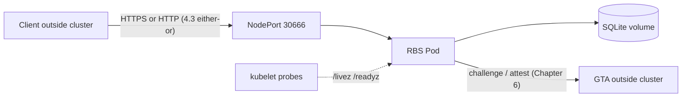

# Deploying RBS on Kubernetes

> Follow the chapters in order; if the actual output doesn't match the expectation, stop, locate and fix the issue per the hints in each step before continuing. See the [RBS Architecture](../design/architecture.md) for the overall architecture.
> The business-port protocol is **either-or**, chosen via 4.3: HTTPS `https://<NODE_IP>:30666` (default) or plaintext HTTP `http://<NODE_IP>:30666` (no certificates; closed demos / trusted intranets only). Wherever the guide shows a `# HTTPS` block and a `# HTTP` block, run yours and skip the other.

**Table of contents**

- [0. Environment self-check](#0-environment-self-check)
- [1. Confirm the cluster is ready](#1-confirm-the-cluster-is-ready)
- [2. Build and import images](#2-build-and-import-images)
- [3. Generate certificates and keys](#3-generate-certificates-and-keys)
- [4. Deploy](#4-deploy)
- [5. Verify](#5-verify)
- [6. Connect a GTA](#6-connect-a-gta)
- [7. Integrate the Vault resource backend (OpenBao)](#7-integrate-the-vault-resource-backend-openbao)
- [8. Integrate the HSM resource backend (SoftHSM2)](#8-integrate-the-hsm-resource-backend-softhsm2)
- [9. Integrate the CA resource backend (XiPKI)](#9-integrate-the-ca-resource-backend-xipki)

**Environment requirements**

| Item | Requirement |
|---|---|
| Machine | ≥ 4 CPUs / 8 GB RAM / 20 GB free disk |
| Operating system | Linux (verified on openEuler; other distros' equivalents apply) |
| Run as | Any user; some commands need sudo |
| Tools | git, Docker, kubectl v1.30+, openssl, curl |
| K8s cluster | An existing working cluster (nodes Ready, kubectl pointing at it); creating the cluster is out of scope |
| GTA service | only needed in Chapter 6 (base URL, credentials user_id, token-signing public key; Option 1 additionally needs the CA and client certificates) |

**Deployment topology**:



Chapters 1–5 are the mainline: SQLite works out of the box (database and tables are created automatically on first start). Chapter 6 connects the GTA; chapters 7–9 integrate one resource backend each on top of Chapter 6.

## 0. Environment self-check

```bash
# 1) CLI tools (expect all [OK])
for c in git kubectl docker openssl curl; do
  command -v "$c" >/dev/null 2>&1 && echo "[OK]      $c" || echo "[MISSING] $c"
done

# 2) Cluster connectivity and storage class
kubectl get nodes          # nodes listed = kubectl points at the cluster; STATUS must be Ready (issues: Chapter 1)
kubectl get storageclass   # a storage class marked (default) is required — Chapter 4's PVC depends on it; if missing, use a branch in Chapter 4 step 5 (mark default / static PV)

# 3) Memory (see the requirements table at the top)
free -h | awk '/^Mem:/{print "Memory: "$2}'
```

Item 1 all `[OK]` and item 2 matching the line-end comments means pass; for any `[MISSING]`, install via the block below and rerun this section.

```bash
# git / openssl / curl missing
sudo dnf install -y git openssl curl
```

> For missing kubectl / docker see their official docs (kubectl must match the cluster's version, and kubeconfig must point at the cluster afterwards).

## 1. Confirm the cluster is ready

> Output of this chapter: nodes **Ready** + `NODE_IP` (Chapters 3, 5 and 6 depend on it — write it down).

```bash
kubectl get nodes -o wide    # 1) STATUS must be Ready; the INTERNAL-IP column is NODE_IP — write it down
kubectl get storageclass     # 2) a (default) storage class is required (Chapter 4's PVC depends on it; if missing, use a branch in Chapter 4 step 5)
```

**When a node is NotReady** (the kubelet is unreachable, Pods pile up in `Pending`/`Terminating` — fix it first):

```bash
systemctl status kubelet    # run on the NotReady node (ssh into it); fix kubelet per the output
kubectl wait --for=condition=Ready node --all --timeout=300s    # after the fix, back on this machine; prints "condition met" on success
```

**When kubectl fails with `Gateway Time-out` / curls to cluster addresses return an HTML proxy page** (only happens in terminals with `http_proxy`/`https_proxy` set — kubectl listing nodes normally = skip this block; service-level proxies like containerd's do not pass through the shell and do not affect kubectl): copy the whole block — addresses are derived automatically; the exports live only in the current terminal, rerun the block in new terminals:

```bash
# 1) API server address from the local kubeconfig (a purely local read — works even while kubectl cannot connect)
API_SERVER=$(kubectl config view --minify -o jsonpath='{.clusters[0].cluster.server}' | sed -E 's#^https?://##; s#:[0-9]+$##')

# 2) Append it to no_proxy together with localhost (existing value untouched)
export no_proxy="${no_proxy:+$no_proxy,}localhost,127.0.0.1,${API_SERVER}"
export NO_PROXY="$no_proxy"

# 3) Check it took effect (nodes listed = working), then append the node IP to no_proxy too (for the NodePort curls in 5.3/6.3 and chapters 7–9)
kubectl get nodes -o wide
NODE_IP=$(kubectl get nodes -o jsonpath='{.items[0].status.addresses[?(@.type=="InternalIP")].address}')
export no_proxy="${no_proxy:+$no_proxy,}${NODE_IP}"
export NO_PROXY="$no_proxy"
```

## 2. Build and import images

> Output of this chapter: the image `globaltrustauthority-rbs/rbs:latest` available inside the cluster (exactly the name the manifests reference). Run the whole chapter from the repository root.

```bash
git clone https://gitcode.com/openeuler/globaltrustauthority-rbs.git    # skip if already cloned
cd globaltrustauthority-rbs
```

### 2.1 Build

```bash
docker build -f deployment/docker/dockerfile -t globaltrustauthority-rbs/rbs:latest .
docker images | grep globaltrustauthority-rbs    # one image line = success
```

> The first build compiles all dependencies and takes tens of minutes — normal (the required clang is installed inside the Dockerfile; two base images are pulled first: `rust:1.88` compile stage, `openeuler/openeuler:24.03-lts` runtime).

**Base-image pull failing with `failed size validation` / `failed to resolve source metadata`** (registry-mirror cache corruption; retry 1–2 times, then bypass — no daemon changes, no restart needed): pull the two base images via an alternate mirror and build again — once they are local, the build no longer contacts the mirror:

```bash
docker pull docker.m.daocloud.io/openeuler/openeuler:24.03-lts && docker tag docker.m.daocloud.io/openeuler/openeuler:24.03-lts openeuler/openeuler:24.03-lts
docker pull docker.m.daocloud.io/library/rust:1.88 && docker tag docker.m.daocloud.io/library/rust:1.88 rust:1.88
docker build -f deployment/docker/dockerfile -t globaltrustauthority-rbs/rbs:latest .
```

> Still failing: try other mirror prefixes (`dockerproxy.net`, `docker.1ms.run`), or fix `registry-mirrors` in `/etc/docker/daemon.json` and `systemctl restart docker`.

**Building behind a proxy** (build containers do not inherit the shell's proxy variables; on `Couldn't resolve host name` inject the proxy, on `SSL peer certificate ... self-signed certificate in certificate chain` also inject the proxy's CA chain — one build covers both; export the Chapter-1 no_proxy pair first, otherwise every later kubectl/curl/rbs-cli call to the cluster fails with 504):

```bash
export https_proxy=$http_proxy    # set if missing (usually the same value)
# 1) Extract the proxy CA chain (expect >= 1; 0 means the proxy is not working for this target — troubleshoot the proxy first, or retry against another HTTPS host)
openssl s_client -proxy ${http_proxy#http://} -connect mirrors.aliyun.com:443 -showcerts </dev/null 2>/dev/null \
  | awk '/BEGIN CERTIFICATE/,/END CERTIFICATE/{print}' > host-ca-bundle.pem    # re-runnable
grep -c "BEGIN CERTIFICATE" host-ca-bundle.pem
docker build -f deployment/docker/dockerfile -t globaltrustauthority-rbs/rbs:latest \
  --build-arg http_proxy=$http_proxy --build-arg https_proxy=$https_proxy \
  --build-arg CA_BUNDLE="$(cat host-ca-bundle.pem)" .
```

> The CA bundle lives only in the build stage and never enters the final image. A `spurious network error` during the build is cargo auto-retrying on a slow network — be patient and do not interrupt.

**407 in the runtime stage** (the build reaches the openEuler `dnf install` step and fails with `Status code: 407` / `CONNECT tunnel failed, response 407`; the proxy gateway admits hosts per domain — it allowed the builder's Debian mirrors but demands authentication for the openEuler repo domains): point dnf at a mirror the gateway admits (Aliyun carries openEuler 24.03 LTS) and rebuild; restore the Dockerfile afterwards (idempotent):

```bash
# 1) Insert a repo-rewrite RUN before the runtime dnf (drops the metalink line so dnf uses baseurl, and redirects repo.openeuler.org to the Aliyun mirror — gpgkey covered too)
sed -i '/^FROM openeuler\/openeuler:24.03-lts/a RUN sed -i -e "/^metalink=/d" -e "s|repo.openeuler.org/openEuler-24.03-LTS|mirrors.aliyun.com/openeuler/openEuler-24.03-LTS|g" /etc/yum.repos.d/openEuler.repo' deployment/docker/dockerfile

# 2) Rebuild — every builder-stage layer is cached, so the build resumes at the runtime stage
docker build -f deployment/docker/dockerfile -t globaltrustauthority-rbs/rbs:latest \
  --build-arg http_proxy=$http_proxy --build-arg https_proxy=$https_proxy \
  --build-arg CA_BUNDLE="$(cat host-ca-bundle.pem)" .

# 3) Restore the Dockerfile after the build succeeds
git checkout -- deployment/docker/dockerfile
```

> The injected RUN does become a layer of the final image, leaving its yum repo pointing at the substitute mirror — harmless in proxy-restricted environments (the substitute is the reachable one). Use any other gateway-admitted mirror site by replacing the domain in the sed.

### 2.2 Import

The cluster cannot read images from the build machine's Docker — each node's containerd and the build machine's Docker are separate stores. Pack the image under the **same name**, deliver it to the node, and store it into the node's containerd:

```bash
kubectl get nodes -o wide    # note the INTERNAL-IP column and fill NODE_IP below; multi-node clusters need the import on every node (a node missing the image reports ErrImagePull — rerun this block with its IP)
NODE_USER=root               # ← the user you log into the node with (root or any sudo-capable user)
NODE_IP=192.168.49.2         # ← the value you looked up (same IP as Chapter 3; for cloud nodes not directly reachable, the address you actually log in with)
echo "${NODE_USER}@${NODE_IP}"    # echo check — refill if wrong
docker save -o rbs.tar globaltrustauthority-rbs/rbs:latest
scp -o StrictHostKeyChecking=accept-new rbs.tar ${NODE_USER}@${NODE_IP}:/tmp/    # first connection auto-accepts the node fingerprint; password logins prompt for the ssh/sudo password
ssh -t ${NODE_USER}@${NODE_IP} "sudo ctr --namespace k8s.io images import /tmp/rbs.tar && sudo crictl images | grep globaltrustauthority-rbs && sudo rm -f /tmp/rbs.tar"
# the last command printing one globaltrustauthority-rbs/rbs line = success; if the import didn't land, re-check that the image name matches the 2.1 build output exactly
```

Check the import result on the node with `crictl images`: the `docker.io/library/` prefix there is just the fully-qualified form of a bare name; the manifest image name is unchanged.

**The build machine is the node itself (single-machine deployment)**: import directly without touching disk:

```bash
docker save globaltrustauthority-rbs/rbs:latest | sudo ctr --namespace k8s.io images import -
```

**Legacy clusters** (CONTAINER-RUNTIME column shows `docker://`): replace the ctr import above with `docker load`:

```bash
sudo docker load -i /tmp/rbs.tar
```

This guide covers delivering the image to the current cluster only; to share images across clusters/environments, use an image registry (company Harbor, cloud ACR, ...) on your own.

## 3. Generate certificates and keys

> Output of this chapter: the `rbs-k8s-deploy/` directory; its files go into the Chapter 4 Secrets. Run from the repository root. Execute per protocol:
> - **HTTPS** (4.3 Option 1): run 3.1 + 3.2 — 6 files in total;
> - **HTTP** (4.3 Option 2): run 3.2 only — 4 files in total; **skip 3.1 entirely** (no TLS pair, and 4.2 is skipped).

```bash
kubectl get nodes -o wide    # the INTERNAL-IP column is the node IP
NODE_IP=192.168.49.2    # ← replace with the value you looked up
echo "NODE_IP=$NODE_IP"  # empty echo means the line above was not run or not edited
```

> `NODE_IP` lives only in the current terminal — re-set it in new terminals, otherwise the issued certificate lacks the node IP in its SAN (5.3 fails). For multi-node or load-balanced access, fill in the address clients actually reach (a node IP, a VIP or the LB address) and make sure that address is in the certificate SAN.

### 3.1 TLS server certificate (HTTPS only; skip this section for HTTP)

```bash
mkdir -p rbs-k8s-deploy && cd rbs-k8s-deploy
# the SAN must contain the node IP — 5.3 verifies with it
openssl req -x509 -newkey rsa:2048 -keyout tls.key -out tls.crt -days 365 -nodes \
  -subj "/CN=rbs.local" \
  -addext "subjectAltName=DNS:rbs.local,DNS:localhost,IP:${NODE_IP},IP:127.0.0.1" \
  -addext "basicConstraints=critical,CA:FALSE" \
  -addext "keyUsage=critical,digitalSignature,keyEncipherment" \
  -addext "extendedKeyUsage=serverAuth"
cd ..    # back to the repository root (3.2 runs from there)
```

### 3.2 Key pairs (required for both protocols)

```bash
mkdir -p rbs-k8s-deploy && cd rbs-k8s-deploy    # creates the directory when 3.1 was skipped (idempotent, harmless)

# 1) Administrator key pair (bootstraps the Administrator, signs admin JWTs)
openssl genrsa -out admin_key.pem 2048
openssl rsa -in admin_key.pem -pubout -out admin_pub.pem

# 2) GTA token-signing public key (placeholder; replaced in Chapter 6)
openssl genrsa -out attest_key.pem 2048
openssl rsa -in attest_key.pem -pubout -out attest_pub.pem

cd ..    # back to the repository root
```

### 3.3 Verify

```bash
# 1) HTTPS only: the certificate SAN contains the node IP (expect: IP Address:192.168.49.2)
openssl x509 -in rbs-k8s-deploy/tls.crt -noout -text | grep -A1 "Subject Alternative Name"

# 2) All files needed by the Chapter 4 Secrets exist (listed without "No such file" = pass)
ls rbs-k8s-deploy/{tls.key,tls.crt,admin_key.pem,admin_pub.pem,attest_key.pem,attest_pub.pem}    # HTTPS: 6 files
ls rbs-k8s-deploy/{admin_key.pem,admin_pub.pem,attest_key.pem,attest_pub.pem}                    # HTTP: 4 files
```

```text
X509v3 Subject Alternative Name:
    DNS:rbs.local, DNS:localhost, IP Address:192.168.49.2, IP Address:127.0.0.1
```

## 4. Deploy

> Output of this chapter: RBS running in the `rbs` namespace. **The order cannot change**: namespace → Secrets/ConfigMap → PVC → Deployment/Service. On a redeploy (new images/certificates), run step 0 first, then steps 1–7; skip step 0 on a first deployment.

**0) Clean up old resources** (skippable on a first deployment — `--ignore-not-found` silently skips resources that do not exist):

> **Deleting the entire namespace wipes all SQLite data — unrecoverable** (the mainline is demo-grade: SQLite out of the box, the admin key bootstrapped on first start; a clean reinstall restores factory state).

**Full reinstall (default): delete the namespace**, then run steps 1–7 again (every "expected" output of steps 1–7 is `created` — the Deployment, the Secrets, the ConfigMap and the `rbs-data` PVC are all wiped, and the default storage class reclaims with Delete, so the on-node data directory goes too):

```bash
kubectl delete namespace rbs --ignore-not-found=true
kubectl get ns rbs 2>/dev/null && echo "still deleting, re-check shortly" || echo "[OK] cleanup complete"    # expected: [OK] cleanup complete
```

**To keep the SQLite data: do NOT delete the namespace** — delete only the workloads and the Secrets/ConfigMap, then re-run steps 2–4 and step 7 (skip the namespace apply in step 1 and the PVC apply in step 5 — the old PVC is kept):

```bash
kubectl delete deployment rbs -n rbs --ignore-not-found=true
kubectl delete secret rbs-tls rbs-config -n rbs --ignore-not-found=true
kubectl delete configmap rbs-keys -n rbs --ignore-not-found=true
```

> `unchanged` outputs and the old PVC AGE on that path are expected, not errors.

**Why cleanup is required**: `kubectl apply` only recreates Pods when the manifest content actually changes — a running Pod never switches to a same-tag new image on its own; `kubectl create secret` fails with `AlreadyExists` if the name is taken.

**1) Create the namespace** (first):

```bash
kubectl apply -f deployment/k8s/namespace.yaml    # expected: namespace/rbs created
```

**2) Create the TLS Secret** (Option 1 HTTPS only; Option 2 plain HTTP skips this step — see the two options in step 3, whose sed pairs with skipping this step. The Deployment mounts the Secret as `optional`, so the pod starts without it):

```bash
kubectl create secret tls rbs-tls -n rbs \
  --cert=rbs-k8s-deploy/tls.crt --key=rbs-k8s-deploy/tls.key
kubectl get secret rbs-tls -n rbs    # expected: rbs-tls   kubernetes.io/tls   2   xs
```

**3) Generate the runtime config and create its Secret** (`GTA_BASE_URL`/`GTA_USER_ID` only change in Chapter 6). One shared step generates the config file first; when creating the Secret, **pick one of the two transport options**:

```bash
GTA_BASE_URL=https://127.0.0.1:8083   # ← change to the real GTA address in Chapter 6
GTA_USER_ID=rbs-service               # ← change to the real GTA credentials user_id in Chapter 6

cat > rbs-k8s-deploy/rbs.yaml <<EOF
rest:
  listen_addr: "0.0.0.0:6666"
  https:
    enabled: true
    cert_file: "/etc/rbs/tls/tls.crt"
    key_file: "/etc/rbs/tls/tls.key"

health:
  listen_addr: "0.0.0.0:6667"

logging:
  level: info
  format: text

auth:
  attest_token:
    public_key_path: "/etc/rbs/keys/attest_pub.pem"
    issuer: "Global Trust Authority"
  bearer_token:
    issuer: "rbs-cli"
    audience: "globaltrustauthority-rbs"

admin:
  admin_key:
    public_key_path: "/etc/rbs/keys/admin_pub.pem"

policy:
  max_per_user: 10

attestation:
  default_as_provider: gta
  backends:
    gta:
      mode: rest
      rest:
        base_url: "${GTA_BASE_URL}"
        timeout_secs: 30
        retries: 3
        tls_verify: true
        ca_file: ""
        credentials:
          user_id: "${GTA_USER_ID}"
          api_key_auth: false
          main_api_key: ""
          sub_api_key: ""

storage:
  db_type: sqlite
  max_connections: 10
  timeout: 30
  url: "sqlite:///var/lib/rbs/rbs.db?mode=rwc"
  sql_file_path: "/usr/share/rbs/sqlite_rbs.sql"
EOF
grep -n "base_url\|user_id" rbs-k8s-deploy/rbs.yaml    # expected: both lines carry values; `""` = the two vars above were unset in this shell — re-run the block

```

**Option 1: HTTPS (default, recommended)** — the config exactly as generated above; create the Secret directly:

```bash
kubectl create secret generic rbs-config -n rbs --from-file=rbs.yaml=rbs-k8s-deploy/rbs.yaml
kubectl get secret rbs-config -n rbs    # expected: rbs-config   Opaque   1   xs
```

**Option 2: plain HTTP** (skip 4.2; plaintext transport, closed demos/trusted networks only) — **the sed IS the config edit**: skipping it and creating the Secret directly leaves the server starting as HTTPS (and with 4.2 skipped there is no certificate, so the pod crashes). Copy the whole block:

```bash
# 1) Transport switch: flip enabled to false (cert_file/key_file may stay — not read when false)
sed -i 's/^    enabled: true/    enabled: false/' rbs-k8s-deploy/rbs.yaml

# 2) Self-check: exactly one line, value false, before continuing
grep -n "enabled:" rbs-k8s-deploy/rbs.yaml

# 3) Create the Secret
kubectl create secret generic rbs-config -n rbs --from-file=rbs.yaml=rbs-k8s-deploy/rbs.yaml
kubectl get secret rbs-config -n rbs    # expected: rbs-config   Opaque   1   xs
```

**4) Create the public-key ConfigMap** (public keys are non-secret; created straight from files):

```bash
kubectl create configmap rbs-keys -n rbs \
  --from-file=admin_pub.pem=rbs-k8s-deploy/admin_pub.pem \
  --from-file=attest_pub.pem=rbs-k8s-deploy/attest_pub.pem
kubectl get configmap rbs-keys -n rbs    # expected: rbs-keys   2   xs
```

**5) Create the PVC** (the mainline is the first block only; once the PVC is Bound this step is done and every later block is skipped — go below only if it stays Pending):

```bash
kubectl get storageclass    # is there a storage class? is it marked (default)?
kubectl apply -f deployment/k8s/pvc.yaml    # expected: persistentvolumeclaim/rbs-data created
kubectl get pvc -n rbs    # expected: rbs-data Bound; with WaitForFirstConsumer classes it legitimately shows Pending until the Deployment's Pod schedules — a name in the STORAGECLASS column means someone is supplying (an empty column means no one is)
```

**When a PVC is stuck Pending**:

```bash
kubectl describe pvc rbs-data -n rbs    # an event like `no persistent volumes available ... and no storage class is set` means nothing supplies it — use the matching branch below
```

**A storage class is listed, just without the (default) marker → mark it default** (future PVCs get disks automatically):

```bash
kubectl patch storageclass <storage-class-name> --type merge -p '{"metadata":{"annotations":{"storageclass.kubernetes.io/is-default-class":"true"}}}'    # ← replace <storage-class-name> with the NAME column value you looked up above
kubectl delete pvc rbs-data -n rbs    # delete it only while it is still Pending — **never delete a Bound PVC: the data volume lives on it**
kubectl apply -f deployment/k8s/pvc.yaml
kubectl get pvc -n rbs    # still Pending is normal: most storage classes use WaitForFirstConsumer and bind when the Deployment's Pod schedules
```

**No storage class at all (No resources found) → static PV** (zero dependencies, works offline, fine on single-node): hand-create the PV matching pvc.yaml one-to-one, then continue with step 6:

```yaml
# save as rbs-pv.yaml, then kubectl apply -f rbs-pv.yaml
apiVersion: v1
kind: PersistentVolume
metadata:
  name: rbs-data-pv
spec:
  capacity:
    storage: 1Gi
  accessModes: ["ReadWriteOnce"]
  persistentVolumeReclaimPolicy: Retain
  hostPath:
    path: /data/rbs/rbs-data
    type: DirectoryOrCreate
```

> Extra PVs stay Available — harmless, delete them. Multi-node: pin each PV with `nodeAffinity`, or install a default storage class (with internet: local-path-provisioner — github.com/rancher/local-path-provisioner); PVCs already bound to static PVs are unaffected by a later default storage class.

**6) Prepare the data directory** (static-PV branch only — the dynamic mainline skips this step). The directory must exist and be owned by uid 999 (the container user), else the pod crash-loops on `(code: 14) unable to open database file`. Run on the node:

```bash
sudo mkdir -p /data/rbs/rbs-data
sudo chown -R 999:999 /data/rbs/rbs-data
```

**7) Apply the Deployment and Service** (the mainline is the first block only; the blocks below cover an alternative invocation, redeployment and error handling — run them only when the matching situation appears):

```bash
kubectl apply -f deployment/k8s/deployment.yaml  # expected: deployment.apps/rbs created
kubectl apply -f deployment/k8s/service.yaml     # expected: service/rbs created
```

**`apply` failing with `provided port is already allocated`** = another Service already holds 30666 (NodePorts are cluster-wide unique) — move RBS to another port:

```bash
kubectl get svc -A | grep 30666    # any output = the port is taken (no need to care who holds it)
```

```bash
kubectl get svc -A | grep 31666 || echo "31666 free"    # confirm the new port is free (valid NodePort range 30000-32767; any free value works)
sed -i 's/30666/31666/g' deployment/k8s/service.yaml
kubectl apply -f deployment/k8s/service.yaml
kubectl get svc -n rbs    # expected: rbs ... 6666:31666/TCP
```

> After a port change: **certificates need no reissue** (the SAN holds the IP only, not the port); substitute the new port wherever the guide says `:30666` — the 5.3 verification curl, the 6.3 challenge check, the 7.0 base variables (RBS_URL, chapters 7–9), the node firewall. The 5.2 port-forward check does not involve the NodePort.

## 5. Verify

> Output of this chapter: the pod READY 1/1 + probes and business API fully verified.

### 5.1 Wait for the pod to be ready

```bash
kubectl get pods -n rbs -w    # READY 1/1 = success (Ctrl+C to leave the watch)
```

```text
NAME                   READY   STATUS    RESTARTS   AGE
rbs-xxxxxxxxx-xxxxx    1/1     Running   0          40s
```

> First start runs the SQL migration and the admin bootstrap (~30s). Long-unready: `kubectl describe pod <Pod> -n rbs` for the events; RBS logs to stdout — `kubectl logs -n rbs deploy/rbs` (`-f` to follow, `--previous` for the last crash).

**CrashLoopBackOff with the log mentioning a config field**: match the log line —

- `rest.https.cert_file not readable` = 4.3 Option 2 without its sed
- `health.listen_addr must differ` = health and rest share an address
- `execute sql: No such file` = broken `storage.sql_file_path` (keep the template value `/usr/share/rbs/sqlite_rbs.sql`)

Fix `rbs-k8s-deploy/rbs.yaml` (for HTTPS also confirm the `rbs-tls` Secret from 4.2 exists), then delete+recreate rbs-config and restart:

```bash
kubectl delete secret rbs-config -n rbs
kubectl create secret generic rbs-config -n rbs --from-file=rbs.yaml=rbs-k8s-deploy/rbs.yaml
kubectl rollout restart deployment/rbs -n rbs
```

Confirm the transport the server actually started (both modes):

```bash
kubectl logs -n rbs deploy/rbs | grep listening
# HTTPS: RBS REST server listening on https://0.0.0.0:6666
# HTTP:  RBS REST server listening on http://0.0.0.0:6666
```

### 5.2 Probe endpoints

The health port 6667 is not exposed; verify via port-forward. Run the block as a whole (`PF=$!` depends on the background job on the previous line):

```bash
kubectl port-forward -n rbs deploy/rbs 16667:6667 &
PF=$!; sleep 1
curl -s http://localhost:16667/livez;  echo    # expect {"status":"ok"}
curl -s http://localhost:16667/readyz; echo    # expect {"status":"ok"} (includes SQLite)
kill $PF
```

**An `address already in use` error** means a stale port-forward — `pkill -f "kubectl port-forward"` and rerun, or change the local port (e.g. `26667:6667`).

> Troubleshooting hint: a pod event reading `Readiness probe failed: HTTP probe failed with statuscode: 503` carries **only the status code** (kubelet drops HTTP probe response bodies); the actual reason is in the application log: `kubectl logs -n rbs deploy/rbs | grep "readiness probe failed"` (RBS logs the failure reason with details as a WARN).

### 5.3 Business API (from outside the cluster via NodePort 30666)

```bash
NODE_IP=192.168.49.2   # ← replace with the node IP (INTERNAL-IP column of kubectl get nodes -o wide)

# HTTPS — TLS verified with the Chapter-3 certificate
curl -s --cacert rbs-k8s-deploy/tls.crt "https://${NODE_IP}:30666/rbs/version"

# HTTP
curl -s "http://${NODE_IP}:30666/rbs/version"
```

```text
{"service_name":"globaltrustauthority-rbs","api_version":"0",...}
```

From a machine other than the node, real-cluster node IPs are routable on their own — just have 30666/TCP open in the node firewall.

**Call failing from outside the cluster** = check in order: does the access address match the certificate SAN (verified in Chapter 3 — a changed node IP means re-issuing the certificate and recreating the Secrets); is 30666/TCP open in the node firewall; is the request hijacked by a proxy (retry the manual curl with `--noproxy '*'`).

**TLS errors** = the client scheme does not match the server mode: `wrong version number` = HTTPS client against a plain-HTTP server, `Recv failure: Connection reset by peer` = HTTP client against an HTTPS server — align both sides and confirm the active mode with `kubectl logs -n rbs deploy/rbs | grep listening`.

> **Note**: on cloud clusters (no fixed node IP reachable directly) the NodePort approach does not apply — switch the Service to LoadBalancer or Ingress on your own, point the clients at the load-balancer address, and include that address in the certificate SAN.

### 5.4 Data persistence (optional check; the admin is not re-created and data survives a pod restart)

```bash
kubectl delete pod -n rbs -l app=rbs
sleep 20
kubectl get pods -n rbs    # expected: new pod READY 1/1
kubectl logs -n rbs deploy/rbs | grep -i bootstrap
# expected: only "Admin bootstrap check completed" (a first start on an empty volume adds two more bootstrap lines before it: "no users found, creating ..." and "bootstrapped successfully")
```

## 6. Connect a GTA

> Output of this chapter: RBS calls the real GTA for challenge. Prerequisites: a reachable GTA (outside the cluster) with its base URL, credentials user_id, and token-signing public key; Option 1 additionally needs the CA/client certificates (generated by the GTA deployment guide).

**1) Replace the placeholder signing key** (save the GTA's public key as `rbs-k8s-deploy/attest_pub.pem`, then):

```bash
kubectl delete configmap rbs-keys -n rbs
kubectl create configmap rbs-keys -n rbs \
  --from-file=admin_pub.pem=rbs-k8s-deploy/admin_pub.pem \
  --from-file=attest_pub.pem=rbs-k8s-deploy/attest_pub.pem
```

**2) Connect to the GTA (pick one of the two RBS→GTA transport options).** The protocol RBS uses to call the GTA follows your GTA-side deployment (the HTTPS/HTTP choice in chapter 4 of the GTA deployment guide) — pick the matching one here.

Note: this choice is about the **RBS→GTA direction** and is **independent** of the RBS business-port protocol you picked in 4.3 (all four combinations are valid).

Both options are **incremental sed** on the config: only the GTA-related keys change; your 4.3 choice and any later-chapter edits are preserved.

Option 1 needs the GTA's CA and a client certificate; the certificate files must be **mounted inside the RBS container** (host paths are invisible inside the container).

**Option 1: HTTPS + mTLS (default, recommended)** — the GTA is deployed with HTTPS. RBS trusts the GTA's CA (`ca_file`) and presents a client certificate (`client_cert_path`/`client_key_path`). Copy the whole block:

```bash
# 2.1 Create the GTA certificate Secret (change the paths to your actual
#     certificate locations; delete-first, so the block is re-runnable)
kubectl delete secret gta-certs -n rbs --ignore-not-found
kubectl create secret generic gta-certs -n rbs \
  --from-file=ca.crt=/home/xxx/global-trust-authority/gta-certs/ca.crt \
  --from-file=client.crt=/home/xxx/global-trust-authority/gta-certs/client.crt \
  --from-file=client.key=/home/xxx/global-trust-authority/gta-certs/client.key

# 2.2 Mount the certificates into the RBS pod (re-running after it is already
#     mounted fails with Duplicate value — ignore that error)
kubectl patch deployment rbs -n rbs --type='json' -p='[
  {"op":"add","path":"/spec/template/spec/volumes/-","value":{"name":"gta-certs","secret":{"secretName":"gta-certs"}}},
  {"op":"add","path":"/spec/template/spec/containers/0/volumeMounts/-","value":{"name":"gta-certs","mountPath":"/etc/rbs/gta-certs","readOnly":true}}
]'

# 2.3 Edit the config (incremental: only the GTA-related keys are touched —
#     your 4.3 transport choice and any later-chapter edits are preserved)
GTA_BASE_URL=https://192.168.1.100:8083   # ← your GTA's real address: IP:port (https://, matching the GTA-side Option 1)
GTA_USER_ID=rbs-service                   # ← the real GTA credentials user_id

# 1) GTA address and user_id: replace the whole line with the real values above
#    (safe to re-run)
sed -i "s|base_url:.*|base_url: \"${GTA_BASE_URL}\"|" rbs-k8s-deploy/rbs.yaml
sed -i "s|user_id:.*|user_id: \"${GTA_USER_ID}\"|" rbs-k8s-deploy/rbs.yaml

# 2) Verify the peer certificate + mTLS: set tls_verify to true (whole line);
#    replace 4.3's ca_file: "" placeholder with the container-internal mount
#    point and add the client-certificate pair (the ca_file sed matches the ""
#    placeholder, so re-running after the change is a no-op — both idempotent)
sed -i "s|tls_verify:.*|tls_verify: true|" rbs-k8s-deploy/rbs.yaml
sed -i 's|ca_file: ""|ca_file: "/etc/rbs/gta-certs/ca.crt"\n        client_cert_path: "/etc/rbs/gta-certs/client.crt"\n        client_key_path: "/etc/rbs/gta-certs/client.key"|' rbs-k8s-deploy/rbs.yaml

# 3) Self-check: base_url is https://; tls_verify is true; the three
#    certificate keys point into /etc/rbs/gta-certs/
grep -n "base_url\|user_id\|tls_verify\|ca_file\|client_cert_path\|client_key_path" rbs-k8s-deploy/rbs.yaml

# 2.4 Update the Secret and restart (the RBS business-port protocol keeps your 4.3 choice — unrelated here)
kubectl delete secret rbs-config -n rbs
kubectl create secret generic rbs-config -n rbs --from-file=rbs.yaml=rbs-k8s-deploy/rbs.yaml
kubectl rollout restart deployment/rbs -n rbs
kubectl rollout status deployment/rbs -n rbs --timeout=120s
```

**Option 2: plain HTTP** — the GTA is deployed with HTTP (no RBS-side certificates; plaintext transport, no mTLS authentication — closed demos / trusted intranets only). Skip the certificate mounting (no 2.1/2.2) and edit the config only. Copy the whole block:

```bash
# 2.3 Edit the config (incremental: only the GTA-related keys are touched —
#     your 4.3 transport choice and any later-chapter edits are preserved)
GTA_BASE_URL=http://192.168.1.100:8083   # ← your GTA's real address: IP:port (http://, matching the GTA-side Option 2)
GTA_USER_ID=rbs-service                   # ← the real GTA credentials user_id

# 1) GTA address and user_id: replace the whole line with the real values above
#    (safe to re-run)
sed -i "s|base_url:.*|base_url: \"${GTA_BASE_URL}\"|" rbs-k8s-deploy/rbs.yaml
sed -i "s|user_id:.*|user_id: \"${GTA_USER_ID}\"|" rbs-k8s-deploy/rbs.yaml

# 2) Plaintext transport: set tls_verify to false (no CA / client certificate)
sed -i "s|tls_verify:.*|tls_verify: false|" rbs-k8s-deploy/rbs.yaml

# 3) Clear the mTLS certificate keys (unused over plain http; a no-op when
#    never configured)
sed -i 's|ca_file: "/etc/rbs/gta-certs/ca.crt"|ca_file: ""|' rbs-k8s-deploy/rbs.yaml
sed -i '/client_cert_path:/d; /client_key_path:/d' rbs-k8s-deploy/rbs.yaml

# 4) Self-check: base_url is http://; tls_verify is false; ca_file is empty
grep -n "base_url\|user_id\|tls_verify\|ca_file\|client_cert_path\|client_key_path" rbs-k8s-deploy/rbs.yaml

# 2.4 Update the Secret and restart (the RBS business-port protocol keeps your 4.3 choice — unrelated here)
kubectl delete secret rbs-config -n rbs
kubectl create secret generic rbs-config -n rbs --from-file=rbs.yaml=rbs-k8s-deploy/rbs.yaml
kubectl rollout restart deployment/rbs -n rbs
kubectl rollout status deployment/rbs -n rbs --timeout=120s
```

> **Common mistake** (Option 1): writing host paths (e.g. `/home/xxx/...`) for `ca_file` etc. — the container **cannot see the host filesystem**, and startup panics with `Failed to read CA certificate file: NotFound`. Certificate paths must point to the **container-internal mount point** `/etc/rbs/gta-certs/`.

**3) Verify the challenge** (public endpoint, no auth):

```bash
NODE_IP=192.168.49.2   # ← replace with the node IP (INTERNAL-IP column of kubectl get nodes -o wide)

# HTTPS
curl -s --cacert rbs-k8s-deploy/tls.crt "https://${NODE_IP}:30666/rbs/v0/challenge?attester_type=tpm"

# HTTP
curl -s "http://${NODE_IP}:30666/rbs/v0/challenge?attester_type=tpm"
```

A JSON containing `nonce` means success (HTTP 200). If not, check `kubectl logs -n rbs deploy/rbs` and the client symptoms:

**`connection error: Connection reset by peer (os error 104)` repeated `retries` times, client gets 503 `{"error":"service temporarily unavailable"}`** = the `base_url` scheme does not match the GTA server mode (e.g. `http://` configured against an HTTPS GTA); correct the scheme in the config.

**Connection timeout/refused** = `GTA_BASE_URL` unreachable from inside the cluster (verify in the pod: `kubectl exec -n rbs deploy/rbs -- curl -sk --max-time 5 ${GTA_BASE_URL}`).

**Certificate errors (`certificate verify failed` / `self-signed certificate`)** = mount the GTA certificates per **Option 1** and retry; if certificates are truly unavailable, set `tls_verify` to `false` (less secure, only works without mTLS).

> **Note**: the GTA does not validate `attester_type` at challenge time — an unsupported value still returns a nonce.

## 7. Integrate the Vault resource backend (OpenBao)

> Output of this chapter: RBS reads secrets/certs from OpenBao and returns JWE-encrypted content. Prerequisites: Chapter 6 (GTA) done; a reachable OpenBao service (outside the cluster).

### 7.0 Prerequisites (common to chapters 7/8/9)

Prepare once — all three resource-backend chapters use them:

**1) rbs-cli** (resource policy/resource CRUD and JWE decryption):

```bash
# Option A: build from source (from the repo root)
cargo build -p rbs-cli --release
export PATH="$PATH:$(pwd)/target/release"

# Option B: install via RPM (see build_and_install.md)
```

**2) Admin Bearer Token** (required for all admin operations):

```bash
export BEARER_TOKEN="$(rbs-cli token gen --private-key-file rbs-k8s-deploy/admin_key.pem)"
```

**3) Attester key pair** (the attest token's `tee-pubkey`; RBS encrypts the JWE response with it, you decrypt with the paired private key):

```bash
openssl genrsa -out attester_private.pem 4096
openssl rsa -in attester_private.pem -pubout -out attester_public.pem
```

> **Note: this is NOT `attest_pub.pem`!** The two are easily confused but completely different:
>
> | | `attest_pub.pem` (configured in Chapter 6) | `attester_public.pem` (generated in this step) |
> |---|---|---|
> | Belongs to | GTA (server side) | You (client side) |
> | Purpose | RBS verifies GTA-issued tokens are genuine | RBS encrypts resource content returned to you (JWE) |
> | Paired private key | On GTA's side (you don't have it) | In your hands (`attester_private.pem`) |
> | If mixed up | — | RBS encrypts with GTA's public key → you lack the private key → **decryption fails** |
>
> Keep `attester_private.pem` safe — all later `client get-resource --private-key-file attester_private.pem` decryptions depend on it, and it must be the same pair as `attester_public.pem`.

**4) attestation_agent** (a GTA-side component; `client get-token` needs it to collect evidence locally): see the GTA client guide — [attestation_agent user guide](https://atomgit.com/openeuler/global-trust-authority/tree/master/docs/en/client/user_guide.md). Skip if already installed.

**5) Base variables** (shared across the three chapters):

```bash
# HTTPS
NODE_IP=192.168.49.2   # ← replace with the node IP (INTERNAL-IP column of kubectl get nodes -o wide)
export RBS_URL="https://${NODE_IP}:30666"
```

```bash
# HTTP
NODE_IP=192.168.49.2   # ← replace with the node IP (INTERNAL-IP column of kubectl get nodes -o wide)
export RBS_URL="http://${NODE_IP}:30666"
```

Every rbs-cli command in chapters 7–9 is likewise given twice: the `# HTTPS` form carries `--cert rbs-k8s-deploy/tls.crt`, the `# HTTP` form omits it.

**6) Proxy exclusion** (mandatory when `http_proxy`/`https_proxy` is exported — same treatment as Chapter 1, otherwise kubectl/rbs-cli requests to the node IP are hijacked and fail with 504):

```bash
export no_proxy="${NODE_IP},localhost,127.0.0.1"
export NO_PROXY="$no_proxy"
```

### 7.1 Start OpenBao and pre-create a secret

```bash
# On the OpenBao host (dev mode for functional verification; use a persistent deployment in production)
docker run -d --name rbs-openbao -p 8200:8200 \
  openbao/openbao server -dev -dev-root-token-id=root -dev-listen-address=0.0.0.0:8200

# Health check
sleep 3
curl -s -H "X-Vault-Token: root" http://127.0.0.1:8200/v1/sys/health

# Pre-create a secret (corresponds to the RBS resource URI vault/default/secret/mykey)
curl -s -X POST -H "X-Vault-Token: root" -H "Content-Type: application/json" \
  -d '{"data":{"myvalue":"hello-vault","num":42}}' \
  http://127.0.0.1:8200/v1/secret/data/default/secret/mykey
```

### 7.2 Update the RBS config

Chapters 7/8/9 each add one backend into the same top-level `resource:` section. Every chapter therefore uses a guarded two-step edit: step 1 inserts this chapter's backend entry before `storage:` (skipped if it already exists); step 2 adds the `resource:` / `backends:` headers if they are missing. The chapters can be done in any order, and re-running is safe.

```bash
# Add the vault backend entry (skipped if already present)
grep -q '^    vault:' rbs-k8s-deploy/rbs.yaml || sed -i '/^storage:/i\
    vault:\
      type: vault\
      url: "http://<OPENBAO_IP>:8200"\
      token: "root"\
      mount_path: "secret"\
      kv_version: "v2"\
      verify_ssl: false\
      allowed_resource_types: ["secret", "cert"]' rbs-k8s-deploy/rbs.yaml

# Add the resource: headers for the entry above (skipped if another chapter already added them)
grep -q '^resource:' rbs-k8s-deploy/rbs.yaml || sed -i 's/^    vault:/resource:\
  backends:\
    vault:/' rbs-k8s-deploy/rbs.yaml

# Update the Secret and restart
kubectl delete secret rbs-config -n rbs
kubectl create secret generic rbs-config -n rbs --from-file=rbs.yaml=rbs-k8s-deploy/rbs.yaml
kubectl rollout restart deployment/rbs -n rbs
kubectl rollout status deployment/rbs -n rbs --timeout=120s
```

`<OPENBAO_IP>` = the IP of the machine running OpenBao (run `hostname -I | awk '{print $1}'` **on that machine**). It must be reachable from the RBS pod — same principle as the GTA address in chapter 6. Verify before applying:

```bash
kubectl exec -n rbs deploy/rbs -- curl -s --max-time 5 http://<OPENBAO_IP>:8200/v1/sys/health
```

> In production, replace `token: "root"` with a dedicated token and set `verify_ssl: true` with a CA.

Verify registration:

```bash
kubectl logs -n rbs deploy/rbs | grep -i vault | tail -2
# expected: Registered resource backend 'vault' (type=vault, url=http://<OPENBAO_IP>:8200)
```

### 7.3 Create a resource policy and register the resource

Run on the **host**:

```bash
# HTTPS — create a resource policy and register the resource
NODE_IP=192.168.49.2   # ← replace with the node IP (INTERNAL-IP column of kubectl get nodes -o wide)
export RBS_URL="https://${NODE_IP}:30666"
export BEARER_TOKEN="$(rbs-cli token gen --private-key-file rbs-k8s-deploy/admin_key.pem)"

# 1) Create a resource policy
cat > vault_policy.rego <<'EOF'
package verification
default allow = false
allow { true }
result = {"policy_matched": allow}
EOF

rbs-cli -b "$RBS_URL" --cert rbs-k8s-deploy/tls.crt -t "$BEARER_TOKEN" \
  res-policy create --name vault-policy --content @vault_policy.rego
export POLICY_ID="<the returned policy_id>"

# 2) Register the resource (reference only; writes nothing to OpenBao)
rbs-cli -b "$RBS_URL" --cert rbs-k8s-deploy/tls.crt -t "$BEARER_TOKEN" \
  res create --uri vault/default/secret/mykey --policy-id "$POLICY_ID" --content-type json

# 3) Query metadata
rbs-cli -b "$RBS_URL" --cert rbs-k8s-deploy/tls.crt -t "$BEARER_TOKEN" \
  res get-res-info --uri vault/default/secret/mykey
```

```bash
# HTTP — create a resource policy and register the resource
NODE_IP=192.168.49.2   # ← replace with the node IP (INTERNAL-IP column of kubectl get nodes -o wide)
export RBS_URL="http://${NODE_IP}:30666"
export BEARER_TOKEN="$(rbs-cli token gen --private-key-file rbs-k8s-deploy/admin_key.pem)"

# 1) Create a resource policy
cat > vault_policy.rego <<'EOF'
package verification
default allow = false
allow { true }
result = {"policy_matched": allow}
EOF

rbs-cli -b "$RBS_URL" -t "$BEARER_TOKEN" \
  res-policy create --name vault-policy --content @vault_policy.rego
export POLICY_ID="<the returned policy_id>"

# 2) Register the resource (reference only; writes nothing to OpenBao)
rbs-cli -b "$RBS_URL" -t "$BEARER_TOKEN" \
  res create --uri vault/default/secret/mykey --policy-id "$POLICY_ID" --content-type json

# 3) Query metadata
rbs-cli -b "$RBS_URL" -t "$BEARER_TOKEN" \
  res get-res-info --uri vault/default/secret/mykey
```

### 7.4 Get the resource content (attest token + JWE decryption)

```bash
# HTTPS — get the resource content
# 1) Generate an attest token (requires GTA integration + local attestation_agent)
rbs-cli -b "$RBS_URL" --cert rbs-k8s-deploy/tls.crt \
  client get-token --attester-pubkey @attester_public.pem -o /tmp/attest_token.jwt

# 2) Retrieve and decrypt (the CLI does GET + JWE decryption in one step)
rbs-cli -b "$RBS_URL" --cert rbs-k8s-deploy/tls.crt \
  client get-resource \
  --uri vault/default/secret/mykey \
  --attest-token @/tmp/attest_token.jwt \
  --private-key-file attester_private.pem
```

```bash
# HTTP — get the resource content
# 1) Generate an attest token (requires GTA integration + local attestation_agent)
rbs-cli -b "$RBS_URL" \
  client get-token --attester-pubkey @attester_public.pem -o /tmp/attest_token.jwt

# 2) Retrieve and decrypt (the CLI does GET + JWE decryption in one step)
rbs-cli -b "$RBS_URL" \
  client get-resource \
  --uri vault/default/secret/mykey \
  --attest-token @/tmp/attest_token.jwt \
  --private-key-file attester_private.pem
```

Expected output: `{"myvalue":"hello-vault","num":42}` (the secret pre-created in 7.1).

**Challenge failing with `tlsv13 alert certificate required` (mTLS-enforcing GTA, the GTA guide default)**: `client get-token --attester-pubkey` runs the attestation flow in-process via the `attestation_client` SDK, which currently does **not** send the agent client certificate. Obtain the token from the running `attestation_agent` daemon instead — its GTA client does present the configured `server.tls.cert_path`/`key_path`:

```bash
curl -s --unix-socket /var/run/attestation_agent.sock \
  -X POST http://localhost/global-trust-authority/agent/v1/tokens \
  -H "Content-Type: application/json" \
  -d '{"attester_info":[{"attester_type":"tpm_boot"}],"challenge":true,
       "attester_data":{"runtime_data":{"tee-pubkey":{"kty":"RSA","alg":"RSA-OAEP-256","n":"...","e":"AQAB"}}}}'
```

(`attester_info` lists the attesters enabled in the agent config; `tee-pubkey` is `attester_public.pem` as a JWK — `n` = the key modulus, base64url.) The response `{"token":"..."}` feeds step 2 unchanged.

> **Vault backend behavior**: read-only — `res create` only registers a reference; the secret itself must be pre-created in OpenBao. Update/delete only touch the RBS DB record, never the OpenBao content.

## 8. Integrate the HSM resource backend (SoftHSM2)

> Output of this chapter: RBS reads/writes key material in an HSM via PKCS#11. Prerequisites: Chapter 6 (GTA) done; SoftHSM2 installed on the node that will run the RBS Pod (see the note in 8.2).

Opposite to Vault, HSM is **write-mostly**: create/update/delete all operate the HSM. GET accepts attest tokens only (Bearer GETs always return 404).

### 8.1 Install SoftHSM2 and initialize a token

```bash
# On the node that will run the RBS Pod
sudo dnf install -y softhsm
sudo softhsm2-util --init-token --free --label "rbs_slot" --pin 1234 --so-pin 5678
softhsm2-util --show-slots | grep -i label    # expected: Token label: rbs_slot
ls /usr/lib64/pkcs11/libsofthsm2.so           # confirm the module file exists
```

### 8.2 Mount the HSM module and token into the pod

HSM is a local device — mount the module file, token data, and a SoftHSM2 config file into the RBS pod:

```bash
# 1) Create the HSM PIN Secret
kubectl create secret generic rbs-hsm-pin -n rbs --from-literal=pin=1234

# 2) Create a SoftHSM2 config file and turn it into a ConfigMap.
#    /etc/softhsm2.conf does not exist inside the RBS image; without it SoftHSM
#    fails with 'C_Initialize failed ... CKR_GENERAL_ERROR'.
cat > rbs-k8s-deploy/softhsm2.conf <<'EOF'
directories.tokendir = /var/lib/softhsm/tokens/
objectstore.backend = file
log.level = ERROR
slots.removable = false
slots.mechanisms = ALL
library.reset_on_fork = false
EOF
kubectl create configmap rbs-softhsm-conf -n rbs --from-file=softhsm2.conf=rbs-k8s-deploy/softhsm2.conf

# 3) Mount module + tokens + config and inject the PIN env var.
#    The module volume IS the .so file itself, so mount it directly at the target
#    path without subPath (subPath looks for a path INSIDE the volume, and there
#    are no paths inside a file — the pod would hang in
#    CreateContainerConfigError: failed to prepare subPath). The ConfigMap volume
#    below is a directory, so subPath works fine there.
kubectl patch deployment rbs -n rbs --type='json' -p='[
  {"op":"add","path":"/spec/template/spec/volumes/-","value":{"name":"hsm-module","hostPath":{"path":"/usr/lib64/pkcs11/libsofthsm2.so","type":"File"}}},
  {"op":"add","path":"/spec/template/spec/volumes/-","value":{"name":"hsm-tokens","hostPath":{"path":"/var/lib/softhsm/tokens","type":"Directory"}}},
  {"op":"add","path":"/spec/template/spec/volumes/-","value":{"name":"softhsm-conf","configMap":{"name":"rbs-softhsm-conf"}}},
  {"op":"add","path":"/spec/template/spec/containers/0/volumeMounts/-","value":{"name":"hsm-module","mountPath":"/usr/lib/pkcs11/libsofthsm2.so","readOnly":true}},
  {"op":"add","path":"/spec/template/spec/containers/0/volumeMounts/-","value":{"name":"hsm-tokens","mountPath":"/var/lib/softhsm/tokens"}},
  {"op":"add","path":"/spec/template/spec/containers/0/volumeMounts/-","value":{"name":"softhsm-conf","mountPath":"/etc/softhsm2.conf","subPath":"softhsm2.conf","readOnly":true}},
  {"op":"add","path":"/spec/template/spec/containers/0/env","value":[{"name":"RBS_HSM_PIN","valueFrom":{"secretKeyRef":{"name":"rbs-hsm-pin","key":"pin"}}}]}
]'
```

**hostPath volumes read the node's filesystem, not your workstation's** — the two hostPath paths above must exist on the node that runs the RBS Pod: run 8.1 on whichever node that is.

**Multi-node clusters**: either repeat 8.1 on every node or pin the Pod to a prepared node (e.g. with a `nodeSelector`).

Finally, make the token directory writable by the RBS user — the container runs as uid 999 and `fsGroup` does not apply to hostPath volumes:

```bash
# On the node
sudo chown -R 999:999 /var/lib/softhsm/tokens
```

> For production, use a network HSM (no hostPath mounts needed; just set `module_path` to the network HSM's PKCS#11 library).

### 8.3 Update the RBS config

Same guarded two-step edit as 7.2 — append the `hsm` entry and add the `resource:` headers if they are missing:

```bash
# Add the hsm backend entry (skipped if already present)
grep -q '^    hsm:' rbs-k8s-deploy/rbs.yaml || sed -i '/^storage:/i\
    hsm:\
      type: hsm\
      module_path: "/usr/lib/pkcs11/libsofthsm2.so"\
      slot:\
        label: "rbs_slot"\
      credentials:\
        pin_env: "RBS_HSM_PIN"\
      allowed_resource_types: ["key", "secret"]' rbs-k8s-deploy/rbs.yaml

# Add the resource: headers for the entry above (skipped if another chapter already added them)
grep -q '^resource:' rbs-k8s-deploy/rbs.yaml || sed -i 's/^    hsm:/resource:\
  backends:\
    hsm:/' rbs-k8s-deploy/rbs.yaml

# Update the Secret and restart
kubectl delete secret rbs-config -n rbs
kubectl create secret generic rbs-config -n rbs --from-file=rbs.yaml=rbs-k8s-deploy/rbs.yaml
kubectl rollout restart deployment/rbs -n rbs
kubectl rollout status deployment/rbs -n rbs --timeout=120s
```

Verify registration:

```bash
kubectl logs -n rbs deploy/rbs | grep -iE "hsm|slot" | tail -3
# expected: HsmBackend: loaded module '/usr/lib/pkcs11/libsofthsm2.so', found slot 'rbs_slot'
#           Registered resource backend 'hsm' (type=hsm)
```

### 8.4 Create a resource policy and write key material

```bash
# HTTPS — create a resource policy and write key material
NODE_IP=192.168.49.2   # ← replace with the node IP (INTERNAL-IP column of kubectl get nodes -o wide)
export RBS_URL="https://${NODE_IP}:30666"
export BEARER_TOKEN="$(rbs-cli token gen --private-key-file rbs-k8s-deploy/admin_key.pem)"

cat > hsm_policy.rego <<'EOF'
package verification
default allow = false
allow { true }
result = {"policy_matched": allow}
EOF

rbs-cli -b "$RBS_URL" --cert rbs-k8s-deploy/tls.crt -t "$BEARER_TOKEN" \
  res-policy create --name hsm-policy --content @hsm_policy.rego
export POLICY_ID="<the returned policy_id>"

# Generate 32 bytes of random key material
head -c 32 /dev/urandom | base64 > keymat.b64

# Write into the HSM (creates a CKO_DATA object)
rbs-cli -b "$RBS_URL" --cert rbs-k8s-deploy/tls.crt -t "$BEARER_TOKEN" \
  res create --uri hsm/default/key/mykey --policy-id "$POLICY_ID" \
  --content-type binary --content @keymat.b64
```

```bash
# HTTP — create a resource policy and write key material
NODE_IP=192.168.49.2   # ← replace with the node IP (INTERNAL-IP column of kubectl get nodes -o wide)
export RBS_URL="http://${NODE_IP}:30666"
export BEARER_TOKEN="$(rbs-cli token gen --private-key-file rbs-k8s-deploy/admin_key.pem)"

cat > hsm_policy.rego <<'EOF'
package verification
default allow = false
allow { true }
result = {"policy_matched": allow}
EOF

rbs-cli -b "$RBS_URL" -t "$BEARER_TOKEN" \
  res-policy create --name hsm-policy --content @hsm_policy.rego
export POLICY_ID="<the returned policy_id>"

# Generate 32 bytes of random key material
head -c 32 /dev/urandom | base64 > keymat.b64

# Write into the HSM (creates a CKO_DATA object)
rbs-cli -b "$RBS_URL" -t "$BEARER_TOKEN" \
  res create --uri hsm/default/key/mykey --policy-id "$POLICY_ID" \
  --content-type binary --content @keymat.b64
```

### 8.5 Get HSM resource content (attest token only)

```bash
# HTTPS — get HSM resource content
rbs-cli -b "$RBS_URL" --cert rbs-k8s-deploy/tls.crt \
  client get-token --attester-pubkey @attester_public.pem -o /tmp/attest_token.jwt

rbs-cli -b "$RBS_URL" --cert rbs-k8s-deploy/tls.crt \
  client get-resource \
  --uri hsm/default/key/mykey \
  --attest-token @/tmp/attest_token.jwt \
  --private-key-file attester_private.pem
```

```bash
# HTTP — get HSM resource content
rbs-cli -b "$RBS_URL" \
  client get-token --attester-pubkey @attester_public.pem -o /tmp/attest_token.jwt

rbs-cli -b "$RBS_URL" \
  client get-resource \
  --uri hsm/default/key/mykey \
  --attest-token @/tmp/attest_token.jwt \
  --private-key-file attester_private.pem
```

The output is the Base64 encoding of the key material; `base64 -d` matches what was written in 8.4.

> **HSM backend behavior**: write-mostly — create actually writes to the HSM (must carry `--content`, otherwise later GETs fail with 404); update with `--content` overwrites the HSM object; delete actually removes the PKCS#11 object (irreversible).

## 9. Integrate the CA resource backend (XiPKI)

> Output of this chapter: RBS issues certificates live from a CA via CMPv2. Prerequisites: Chapter 6 (GTA) done; a reachable XiPKI service (outside the cluster).

The CA backend is a **certificate-issuance proxy**: create/update/delete are metadata-only; GET takes the CSR from the attest token and issues a certificate live from the CA.

### 9.1 Deploy XiPKI

On the XiPKI host (abbreviated steps; full deployment see [XiPKI docs](https://github.com/xipki/xipki)):

```bash
# Prerequisites: Java 11; download xipki-setup-*.tar.gz to /opt
cd /opt && tar xzf xipki-setup-6.7.0-bclts.tar.gz
rm -f xipki-setup-6.7.0/setup/jars/xipki/bcbridge-fips-6.7.0.jar

# Change the OCSP port (avoid conflicts)
sed -i 's/"ocsp.http.port": "8080"/"ocsp.http.port": "8083"/' xipki-setup-6.7.0/setup/conf.json

# Initialize + start (see the XiPKI official docs for full steps)
cd xipki-setup-6.7.0 && ./prepare.sh && ./demo.sh

# Start the H2 database and the three Tomcats (CA/gateway/OCSP)
# ... full steps in usage_guide/rbs_usage_manual.md chapter 11

# Verify ports
ss -ltn | grep -E ':8444|:8082|:8083'
```

### 9.2 Prepare the CMP client certificate and trust anchors

```bash
# CMP client certificate/key (RBS signs CMP requests with it)
cp /opt/xipki-setup-6.7.0/xipki-cli/xipki/keycerts/cmp-client-cert.pem rbs-k8s-deploy/cmp-client.crt
cp /opt/xipki-setup-6.7.0/xipki-cli/xipki/keycerts/cmp-client.p12 /tmp/cmp-client.p12
openssl pkcs12 -in /tmp/cmp-client.p12 -nocerts -nodes \
  -passin pass:changeit-cmpclient -out /tmp/cmp-client.key.tmp
openssl pkey -in /tmp/cmp-client.key.tmp -out rbs-k8s-deploy/cmp-client.key
rm -f /tmp/cmp-client.key.tmp /tmp/cmp-client.p12

# Trust anchor (the certificate the gateway uses to sign CMP responses)
cp /root/demo_xipki/gateway-tomcat/xipki/keycerts/gateway-server-cert.pem rbs-k8s-deploy/ca-anchors.pem
```

### 9.3 Mount certificates and update the RBS config

```bash
# 1) Create the CA certificate Secret
kubectl create secret generic ca-certs -n rbs \
  --from-file=cmp-client.crt=rbs-k8s-deploy/cmp-client.crt \
  --from-file=cmp-client.key=rbs-k8s-deploy/cmp-client.key \
  --from-file=ca-anchors.pem=rbs-k8s-deploy/ca-anchors.pem

# 2) Mount into the pod
kubectl patch deployment rbs -n rbs --type='json' -p='[
  {"op":"add","path":"/spec/template/spec/volumes/-","value":{"name":"ca-certs","secret":{"secretName":"ca-certs"}}},
  {"op":"add","path":"/spec/template/spec/containers/0/volumeMounts/-","value":{"name":"ca-certs","mountPath":"/etc/rbs/ca-certs","readOnly":true}}
]'

# 3) Add the ca backend entry (skipped if already present) — same guarded two-step edit as 7.2
grep -q '^    ca:' rbs-k8s-deploy/rbs.yaml || sed -i '/^storage:/i\
    ca:\
      type: ca\
      url: "http://<XIPKI_IP>:8082/gw/cmp/myca1"\
      https:\
        verify: false\
      message_protection_cert_file: "/etc/rbs/ca-certs/cmp-client.crt"\
      message_protection_key_file: "/etc/rbs/ca-certs/cmp-client.key"\
      response_protection_trust_anchors_file: "/etc/rbs/ca-certs/ca-anchors.pem"\
      cert_profile: "smime"\
      allowed_resource_types: ["cert"]' rbs-k8s-deploy/rbs.yaml

# 4) Add the resource: headers for the entry above (skipped if another chapter already added them)
grep -q '^resource:' rbs-k8s-deploy/rbs.yaml || sed -i 's/^    ca:/resource:\
  backends:\
    ca:/' rbs-k8s-deploy/rbs.yaml

# 5) Update the Secret and restart
kubectl delete secret rbs-config -n rbs
kubectl create secret generic rbs-config -n rbs --from-file=rbs.yaml=rbs-k8s-deploy/rbs.yaml
kubectl rollout restart deployment/rbs -n rbs
kubectl rollout status deployment/rbs -n rbs --timeout=120s
```

> Replace `<XIPKI_IP>` with the XiPKI host's IP.

Verify registration:

```bash
kubectl logs -n rbs deploy/rbs | grep -iE "CA backend|Registered resource backend 'ca'" | tail -3
# expected: WARN - CA backend: https.verify=false (non-production)
#           INFO - CA backend initialized: url='http://<XIPKI_IP>:8082/gw/cmp/myca1', anchors=1
#           INFO - Registered resource backend 'ca' (type=ca)
```

> The WARN line is expected with this guide's `verify: false` setting, not an error; it disappears once you switch to `verify: true`.

### 9.4 Create a resource policy and register the CA resource

```bash
# HTTPS — create a resource policy and register the CA resource
NODE_IP=192.168.49.2   # ← replace with the node IP (INTERNAL-IP column of kubectl get nodes -o wide)
export RBS_URL="https://${NODE_IP}:30666"
export BEARER_TOKEN="$(rbs-cli token gen --private-key-file rbs-k8s-deploy/admin_key.pem)"

cat > ca_policy.rego <<'EOF'
package verification
default allow = false
allow { true }
result = {"policy_matched": allow}
EOF

rbs-cli -b "$RBS_URL" --cert rbs-k8s-deploy/tls.crt -t "$BEARER_TOKEN" \
  res-policy create --name ca-policy --content @ca_policy.rego
export POLICY_ID="<the returned policy_id>"

# Register the CA resource (metadata only; no request to the CA)
rbs-cli -b "$RBS_URL" --cert rbs-k8s-deploy/tls.crt -t "$BEARER_TOKEN" \
  res create --uri ca/default/cert/mycert --policy-id "$POLICY_ID" --content-type binary
```

```bash
# HTTP — create a resource policy and register the CA resource

NODE_IP=192.168.49.2   # ← replace with the node IP (INTERNAL-IP column of kubectl get nodes -o wide)
export RBS_URL="http://${NODE_IP}:30666"
export BEARER_TOKEN="$(rbs-cli token gen --private-key-file rbs-k8s-deploy/admin_key.pem)"

cat > ca_policy.rego <<'EOF'
package verification
default allow = false
allow { true }
result = {"policy_matched": allow}
EOF

rbs-cli -b "$RBS_URL" -t "$BEARER_TOKEN" \
  res-policy create --name ca-policy --content @ca_policy.rego
export POLICY_ID="<the returned policy_id>"

# Register the CA resource (metadata only; no request to the CA)
rbs-cli -b "$RBS_URL" -t "$BEARER_TOKEN" \
  res create --uri ca/default/cert/mycert --policy-id "$POLICY_ID" --content-type binary
```

### 9.5 Get a certificate (attest token + CSR)

```bash
# Both modes — 1) generate a CSR (subject must match cert_profile)
openssl req -new -newkey rsa:2048 -nodes \
  -keyout csr-client.key -out client.csr \
  -subj "/C=DE/O=myorg/emailAddress=info@myorg.com/CN=workload"
export CSR_DER_B64=$(openssl req -in client.csr -outform DER | base64 -w0)
```

```bash
# HTTPS — 2) issue an attest token carrying the CSR, 3) get the certificate (RBS issues it live from XiPKI; the CLI decrypts the JWE)
rbs-cli -b "$RBS_URL" --cert rbs-k8s-deploy/tls.crt \
  client get-token \
  --attester-pubkey @attester_public.pem \
  --runtime-data "csr=$CSR_DER_B64" \
  -o /tmp/attest_token.jwt

rbs-cli -b "$RBS_URL" --cert rbs-k8s-deploy/tls.crt \
  client get-resource \
  --uri ca/default/cert/mycert \
  --attest-token @/tmp/attest_token.jwt \
  --private-key-file attester_private.pem \
  -o issued-cert.b64
```

```bash
# HTTP — 2) issue an attest token carrying the CSR, 3) get the certificate (RBS issues it live from XiPKI; the CLI decrypts the JWE)
rbs-cli -b "$RBS_URL" \
  client get-token \
  --attester-pubkey @attester_public.pem \
  --runtime-data "csr=$CSR_DER_B64" \
  -o /tmp/attest_token.jwt

rbs-cli -b "$RBS_URL" \
  client get-resource \
  --uri ca/default/cert/mycert \
  --attest-token @/tmp/attest_token.jwt \
  --private-key-file attester_private.pem \
  -o issued-cert.b64
```

```bash
# Both modes — 4) restore and inspect the certificate
base64 -d issued-cert.b64 > issued-cert.der
openssl x509 -in issued-cert.der -inform der -noout -subject -issuer
# expected: subject=C = DE, O = myorg, CN = workload
#           issuer=O = myorg, CN = myca1
```

> **CA backend behavior**: GET issues live — the token must carry both `csr` (DER Base64) and `tee-pubkey`; a missing `csr` yields `400 csr required for this resource provider`. The same CSR within the TTL (default 300 s) returns a cached certificate.

## Further reading

- Build, run, test on a single host: [build_and_install.md](build_and_install.md)
- RPM installation: [rpm.md](rpm.md)
- Sample config with all sections: [rbs/conf/rbs.yaml](../../rbs/conf/rbs.yaml)
